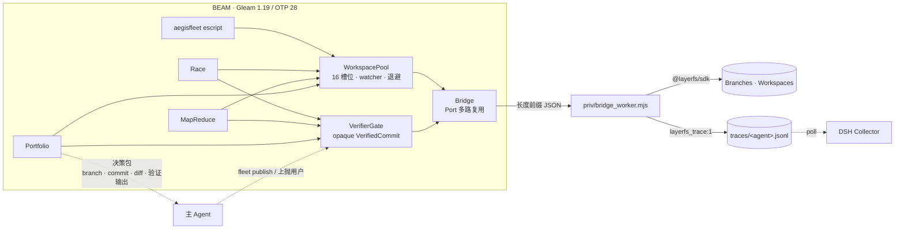

# AegisFleet

**一个用 Gleam (BEAM / OTP 28) 写的确定性多 Agent 舰队控制面**：它接管 LayerFS 的 Branch、Workspace 和 Commit，把原来交给大模型在 Bash 里手写的 `mount → exec → commit → unmount` + `finally` + `for (1..1024)` 垃圾回收，换成有类型、有监督、能在进程崩溃时自动回收的控制面。

**决策权在主 Agent。** 内核只负责执行、验证、回收资源，并把结果整理成决策包返回；**没有任何拓扑会自动发布 `main`**。主 Agent 看完每个候选的分支、Commit、diff 和验证输出后，决定是选一个发布，还是上抛给用户。

本仓库实现设计文档中的 **M1 / M2 全部**、**M3 的 MapReduce 部分**，并新增 **Portfolio**（多方案评估）与显式的 `fleet publish`。DSH 宿主侧的 `FleetSubagentProvider` 与 live Docker 模式尚未启用，边界见「[已验证 / 未验证](#已验证--未验证)」。

---

## 5 分钟跑通

环境要求：Erlang/OTP 28、Node ≥ 22、一个 LayerFS checkout（默认 `/Users/huangzhenyu/Projects/layerfs`，可用 `LAYERFS_DIR` 覆盖）。Gleam 使用 `scripts/env.sh` 选中的 1.19.2（优先 `../.toolchain/gleam`，否则 PATH 上的 `gleam`）。

```bash
cd aegisfleet
./scripts/test.sh          # 11 个内核测试，跑在真实 LayerFS 模拟器上
./scripts/demo.sh          # Race → 报告 → 主 Agent 决策 → 显式发布
./scripts/build.sh         # 生成独立可执行文件 ./aegisfleet
./aegisfleet demo-map-reduce priv/fixture_mr
./scripts/prove_opaque.sh  # 未验证的 Commit 无法通过编译期门禁
node verify/collector_contract.mjs   # DSH 的 Collector 能消费舰队 trace
```

所有 demo 都在临时 LayerFS home 上运行，不会碰你正在使用的 DSH 实例。

一次真实输出：

```
== AegisFleet demo ==
project: demo (sim), home /tmp/aegis-home-vD1VD4
[init] demo @ 3254bdd40ff9
[race] winner race-alpha (commit 12ada40f83…); killed 2 loser(s) in <1ms;
       race took 162ms; NOT published (caller decides)
[decision] main agent chose race-alpha; publishing it
[gate] race-alpha passed /opt/homebrew/opt/node@22/bin/node check.js
[publish] main updated from race-alpha (12ada40f8344)
[check] main:/src/value.txt = 42
[pool] 0/16 Workspaces in use; granted=5 unmounted=5 retries=0 reclaimed=2 queued=0
[trace] 6 DSH trace file(s) in …/traces: alpha.jsonl, beta.jsonl, fleet.jsonl,
        gamma.jsonl, verifier-gate.jsonl, verifier-publish.jsonl
```

`demo` 里那行 `[decision]` 是脚本在扮演主 Agent；真实 DSH 里这一行由主 Agent 自己决定。

---

## 架构



---

## 核心机制

### 1. Bridge：一个 Port，N 个并发调用

`priv/bridge_worker.mjs` 是常驻 Node 进程，从 stdin 读 **4 字节大端长度 + UTF-8 JSON**，向 stdout 写同样格式的帧；诊断全部走 stderr，不会污染帧流。

```json
{"id":7,"op":"mount","args":{"branch":"race-alpha","trace":"alpha"}}
{"id":7,"ok":true,"result":{"path":"/workspaces/3","branch":"race-alpha"}}
{"id":7,"ok":false,"error":{"code":"Busy","message":"…"}}
```

按请求 id 多路复用；`Busy` / `Conflict` / `HeadMoved` 保留原 code，由 BEAM 决定重试或失败。trace 由 SDK 自己按 agent 写盘，不是在 Gleam 里重新编码。

### 2. WorkspacePool：16 槽位 + 进程级 RAII

| 场景 | 行为 |
| :--- | :--- |
| 槽位已满 | checkout 进入 FIFO 队列；排队者有自己的定时器，`queue_timeout` 后返回 `QueueTimeout` |
| mount 返回 `Busy` / `Capacity` | 槽位保留，200ms → 400ms → 800ms …（封顶 5s）退避，默认 5 次 |
| worker 被杀/崩溃 | watcher 收到 DOWN → `unmount(path, discard: true)` → 槽位归还 |
| worker 在 mount 途中被杀 | 标记 `released`；mount 落地后立即丢弃卸载 |
| 挂载点残留 | `fleet reap` 只卸载 `Idle` 且无未提交改动的 Workspace；Bridge 优雅退出时也清理自己登记过的挂载 |
| 租约超时 | 每 `ttl/4` 扫描一次，超过 `lease_ttl_ms` 的活跃租约强制回收 |

watcher 用独立的 checkout id 关联，不靠 pid，避免 pid 复用误伤新租约。

### 3. VerifierGate：编译期锁死主干

- `UnverifiedCommit` 只能由 worker 产出；
- `VerifiedCommit` 的构造器模块私有，唯一入口是 `verify()`，且只在 `exit_code == 0` 时构造；
- `publish()` 的入参类型只有 `VerifiedCommit`。

`./scripts/prove_opaque.sh` 会临时编译一个把 `UnverifiedCommit` 传给 `publish` 的模块，本机输出：

```
error: Type mismatch
  let _ = layer.publish(bridge, candidate, 1_000)
                                 ^^^^^^^^^
Expected type: layer.VerifiedCommit
Found type:    layer.UnverifiedCommit
PASS: the compiler refused to publish unverified code.
```

验证跑在独立的丢弃型 Workspace 里，通过后立即 `discard` 卸载。

### 4. 拓扑算子：只报告，不发布

| 算子 | 做什么 | 何时停 | 输家/中间结果 |
| :--- | :--- | :--- | :--- |
| **Race** | 同一目标的等价尝试（hedge） | 第一个 verified | kill 进程；未提交改动丢弃，已提交 Branch 保留 |
| **MapReduce** | 正交 shard 并行施工后折叠 merge | 全部 shard 完成并合并验证 | 每个 shard 的 Branch 保留 |
| **Portfolio** | 不同实现方案的全量评估 | 全部候选完成 | 不 kill；所有 Branch、Commit、diff 保留 |

三者都**默认不写 `main`**，只返回结果：

- Race 返回 `Won(winner, losers, preempted_ms, published, total_ms)`；
- MapReduce 返回 `Merged(branch, commit, shards, published, total_ms)`；
- Portfolio 返回每个候选的 `Report` 和 `List(VerifiedCommit)`。

只有调用方显式传 `publish: True`（CLI 的 `--publish`）或之后执行 `fleet publish`，`main` 才会变。

### 5. 决策权在主 Agent：两次调用，不是一次

```
主 Agent ── fleet portfolio ──▶ 内核执行/验证/回收 ──▶ 决策包（stdout）
   │                                                     │
   ├── 选择其中一个 branch ── fleet publish <branch> --verify "<cmd>"
   │                                                     └── 重新验证 → 发布 main
   └── 上抛给用户（提问 / 展示 diff / 让用户选）
```

`fleet portfolio` 输出既是给人看的表，也是一行机器可读的 `[packet]` JSON：

```json
{"aegisfleet":1,"kind":"portfolio","project":"pf2","published":null,
 "candidates":[{"name":"a","branch":"pf-a","commit":"1279…","changed":1,
 "files":["/src/value.txt"],"checkMs":59,"status":"verified","detail":"accepted 42"}, …]}
```

`published: null` 是显式的：内核没有替你做决定。主 Agent 可以据此选择发布、或者先问用户。

`fleet publish <branch> --verify "<cmd>"` 是主 Agent 的动作：它重新在该 Branch 当前 head 上跑验证，确认 head 在验证期间没有移动，并按这次验证的 Commit id `publish`（而不是发布一个可能已经移动的 head）。类型门禁仍然生效——发布用的 `VerifiedCommit` 必须是这次 `verify` 产生的。

---

## Race、MapReduce、Portfolio 怎么选

- **Race**：所有候选在追同一个正确解，验收命令本身就是目标（flaky 测试重跑、同一修复的不同随机种子、纯搜索）。这时先到先得不会丢信息；`--publish` 可以把“主 Agent 已预先决定”的场景做成全自动。
- **MapReduce**：任务是正交分片，需要全部合并，没有“选哪个”的问题。
- **Portfolio**：候选是**不同实现方案**，`npm test` 通过只是必要条件；第一个跑完的往往只是最快，不是最好。默认全部跑完、全部验证、全部保留，由主 Agent / 用户决定。

---

## 已验证 / 未验证

### 已验证（可复跑）

| 验证 | 命令 | 结果 |
| :--- | :--- | :--- |
| worker 被杀后自动卸载、槽位归还 | `./scripts/test.sh` → `crash_reclaims_workspace_test` | `in_use=0`、`snapshot.workspaces=[]` |
| 容量上限与排队 | `capacity_queues_test` | 3 worker / 2 槽位：第 3 个排队，杀 1 个后获得租约 |
| 排队超时不会泄漏租约 | `queue_timeout_refuses_waiter_test` | 槽位永不解锁时 waiter 在 250ms 被拒绝，队列清空 |
| Bridge 类型化解码与 trace | `bridge_answers_and_traces_fork_test` | trace 行含 `layerfs_trace:1` 与分支名 |
| `Busy` 自动退避重试 | `busy_mount_is_retried_test`（注入 2 次 Busy） | `retries >= 2`，租约最终成功 |
| Race 赢家不自动发布 | `race_reports_winner_without_publishing_test` | winner 返回、`main` 仍为 0；显式 `publish` 后才变 42 |
| Race 全失败不发布 | `race_without_a_verified_candidate_publishes_nothing_test` | `AllFailed`，`main` 保持 0 |
| Portfolio 全量评估后才发布 | `portfolio_evaluates_all_before_choosing_test` | 3 个不同实现全部通过、`main` 仍为 0；调用方选 `pf-c` 发布后才变 44 |
| MapReduce 合流 | `map_reduce_merges_independent_shards_test` | 合并分支通过集体验证后发布，`main` 同时含 A/B |
| 合并冲突 | `map_reduce_conflict_publishes_nothing_test` | `MergeFailed` 含 `Conflict`，`main` 无冲突文件 |
| 编译期门禁 | `./scripts/prove_opaque.sh` | 编译失败并点名 `VerifiedCommit` |
| DSH Collector 消费 trace | `node verify/collector_contract.mjs` | 接受 5 行、归属 `racer-1`，含 `exitCode` 与 `commit` |
| 残留挂载 janitor | `node verify/leak_reap.mjs` | `kill -9` 后残留 `/workspaces/1`，新 bridge `reap` 清掉 |
| `lfs` CLI 补丁可应用 | `git apply --check integration/lfs-fleet.patch` | 干净应用（在 layerfs checkout 上验证） |
| 独立 escript | `./scripts/build.sh && ./aegisfleet demo priv/fixture` | 无需 `gleam run` 也能完整跑通 |

### 未验证 / 未实现（不要当成已完成）

- **Live Docker 模式未跑**。Bridge 通过 `AEGIS_SDK` / `AEGIS_OPERATOR` 选择 SDK 入口，理论上换 live 入口即可；本次所有验证都在 LayerFS 模拟器上完成。
- **DSH GUI 里还看不到舰队**。trace 协议已用真实 Collector 验证，但显示还需要 Provider 把 `agentId` 绑到真实 root session；`FleetSubagentProvider` 需要改宿主，未实现。
- **`FleetSubagentProvider` 未实现**。它需要改 `@dsh-layerfs/host`（本会话无写权限），只交付了 `lfs.js` 补丁。
- **没有自动“选优”**。Portfolio 只提供可比较的事实（branch、commit、改动文件、验证耗时、stdout）；“哪个更好”与是否上抛由主 Agent / 用户决定。要做自动排序需要显式指标（benchmark、reviewer 分数），不应偷偷用“先通过”代替。
- **`FactBlackboardActor`、`Pipeline`、Mist HTTP、Rustler NIF** 未实现。
- **CPU 级抢占的边界**：`sandbox.exec` 不暴露子进程句柄，所以 Race 的抢占是“杀死 BEAM worker + 丢弃 Workspace + 结构上禁止 commit/publish”，不是给远端 shell 发 SIGKILL。输家的 `sleep 5` 可能仍在已丢弃目录里跑完，但它不可能再发布；已 commit 的 Branch 保留。
- 池的 16 槽位是控制面自己的容量观；多控制面共享 Sandbox 时 `Capacity` 会走退避重试，但槽位记账不跨控制面。
- TTL 回收已实现但未被测试覆盖（崩溃走 watcher，毫秒级；TTL 只兜底“进程活着但挂死”）。

---

## 接进正在运行的 DSH

### 已交付：`lfs` CLI 补丁

`integration/lfs-fleet.patch` 给 `dsh/packages/host/src/lfs.js` 增加 `fleet` 子命令（`integration/lfs.js` 是打好补丁的完整文件），已在真实 checkout 上 `git apply --check` 通过：

```bash
export AEGIS_FLEET_BIN=/path/to/aegisfleet
node "$DSH_LAYERFS_CLI" fleet portfolio --verify "npm test" \
  approach-a:node try_a.js approach-b:node try_b.js approach-c:node try_c.js
# 看报告后，主 Agent 决定：
node "$DSH_LAYERFS_CLI" fleet publish approach-b --verify "npm test"
```

### 未交付：Provider / 生命周期随动

宿主侧需要动 `packages/host/src/index.js`（`ctx.effect(ensureFleetDaemon)`、`ctx.subagents.registerProvider("fleet", …)`）与 `env.js`（注入 `AEGIS_FLEET_BIN`）。本会话的工作区写权限只覆盖当前文件夹，因此没有改 DSH 源树。

Provider 的最小闭环：

1. 子 Agent 启动前：分配 Branch + `WorkspacePool.checkout`；
2. 子 Agent 结束后：**把结果（branch / commit / diff / verifier 输出）作为工具结果交回主 Agent**，不自动 publish；
3. 用户点 Stop 或子 Agent 崩溃：由 watcher 兜底 `Release`/`unmount`；
4. 把 `agentId → {root, name}` 写进 `bindings.json`（Bridge 已有 `bind` op），trace 自动出现在 `Work` 面板；
5. 主 Agent 决定 `fleet publish` 或上抛；这一步对应 DSH 的对话层，不在内核里。

---

## 目录

```
aegisfleet/
├── gleam.toml
├── priv/
│   ├── bridge_worker.mjs        # 常驻 Node 桥：帧协议、SDK 调用、trace、janitor
│   ├── fixture/                 # Race demo 工程
│   ├── fixture_mr/              # MapReduce demo 工程
│   └── fixture_portfolio/       # Portfolio demo：42/43/44 三种都算通过
├── src/
│   ├── aegisfleet.gleam         # escript 入口
│   ├── aegis_native.erl         # Port / env / argv / priv_dir 等 FFI
│   └── aegis/
│       ├── config.gleam
│       ├── native.gleam
│       ├── bridge.gleam         # Port 多路复用、错误分类、重试判定
│       ├── sdk.gleam            # 类型化 LayerFS 调用与 JSON 解码
│       ├── workspace_pool.gleam # 16 槽位、watcher、退避、sweep
│       ├── worker_runner.gleam  # checkout → exec → commit → UnverifiedCommit
│       ├── verifier_gate.gleam  # 独立 Workspace 跑 check → VerifiedCommit
│       ├── domain/layer.gleam   # opaque 类型与唯一验证入口
│       ├── domain/plan.gleam    # Candidate / Shard / FleetPlan ADT
│       ├── topologies/race.gleam
│       ├── topologies/map_reduce.gleam
│       └── topologies/portfolio.gleam
├── test/                        # 11 个 gleeunit 测试
├── verify/                      # Node 侧协议与 Collector 契约验证
├── integration/                 # lfs.js 补丁与完整文件
└── scripts/                     # env / test / demo / build / prove_opaque
```

环境说明：Gleam 二进制在 `../.toolchain/gleam`（1.19.2，本机 Homebrew 版本过旧），`scripts/env.sh` 会优先使用它，找不到时回退到 PATH，也可用 `GLEAM_BIN` 覆盖；hex 缓存放在 `../.home`（本会话沙箱不允许写 `~/Library/Caches`）。在正常机器上直接 `gleam` 即可。
