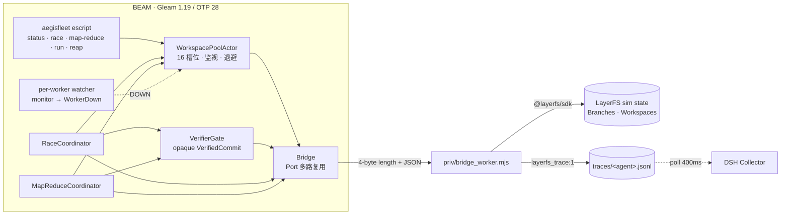

# AegisFleet

**一个用 Gleam (BEAM / OTP 28) 写的确定性多 Agent 舰队控制面**：它接管 LayerFS 的 Branch、Workspace 和 Commit，把原来交给大模型在 Bash 里手写的 `mount → exec → commit → unmount` + `finally` + `for (1..1024)` 垃圾回收，换成有类型、有监督、能在进程崩溃时自动回收的控制面。

本仓库实现的是设计文档中的 **M1 / M2 全部**与 **M3 的 MapReduce 部分**，并对接真实 LayerFS 模拟器做了端到端验证。DSH 宿主侧的 `FleetSubagentProvider` 与 live Docker 模式**尚未启用**，边界见「[已验证 / 未验证](#已验证--未验证)」。

---

## 5 分钟跑通

环境要求：Erlang/OTP 28、Node ≥ 22、一个 LayerFS checkout（默认 `/Users/huangzhenyu/Projects/layerfs`，可用 `LAYERFS_DIR` 覆盖）。Gleam 使用 `scripts/env.sh` 里钉住的 1.19.2（本机 Homebrew 的 1.11 拉不动当前 hex 包）。

```bash
cd aegisfleet
./scripts/test.sh          # 9 个内核测试，跑在真实 LayerFS 模拟器上
./scripts/demo.sh          # Race：3 分支赛马，赢家过验证门禁后发布
./scripts/build.sh         # 生成独立可执行文件 ./aegisfleet
./aegisfleet demo-map-reduce priv/fixture_mr
./scripts/prove_opaque.sh  # 证明未验证的 Commit 无法通过编译期门禁
node verify/collector_contract.mjs   # 证明 DSH 的 Collector 能消费舰队 trace
```

`scripts/env.sh` 会创建一个临时 LayerFS home，把 `AEGIS_*` 指向模拟器；所有测试与 demo 都不会碰你正在运行的 DSH 实例。

一次真实输出（本机）：

```
== AegisFleet demo ==
project: demo (sim), home /tmp/aegis-home-cXaFpU
[init] demo @ 3254bdd40ff9
[race] winner race-alpha (commit 12ada40f83…) published to main;
       killed 2 loser(s) in <1ms; race took 175ms
[publish] main:/src/value.txt = 42
[pool] 0/16 Workspaces in use; granted=4 unmounted=4 retries=0 reclaimed=2 queued=0
[trace] 5 DSH trace file(s) in /tmp/aegis-home-cXaFpU/traces:
        alpha.jsonl, beta.jsonl, fleet.jsonl, gamma.jsonl, verifier-gate.jsonl
```

---

## 架构



**进程所有权**：CLI 进程启动 `Bridge`（拥有 Port）和 `WorkspacePoolActor`；每个候选是一个独立的 BEAM 进程；每个 worker 进程由 pool 派生一个 watcher 进程。worker 无论被 `process.kill`、崩溃还是正常退出，watcher 都会把 DOWN 变成 `WorkerDown(id)`，pool 随之 `unmount(discard: true)` 并归还槽位。

---

## 核心机制

### 1. Bridge：一个 Port，N 个并发调用

`priv/bridge_worker.mjs` 是常驻 Node 进程，从 stdin 读 **4 字节大端长度 + UTF-8 JSON**，向 stdout 写同样格式的帧；所有诊断走 stderr，因此永远不会污染帧流。Erlang 侧用 `{packet, 4}` 打开 Port 后，两个方向自动完成分帧。

```json
{"id":7,"op":"mount","args":{"branch":"race-alpha","trace":"alpha"}}
{"id":7,"ok":true,"result":{"path":"/workspaces/3","branch":"race-alpha"}}
{"id":7,"ok":false,"error":{"code":"Busy","message":"…"}}
```

Bridge 内部按请求 id 多路复用：`mount`、`exec`、`commit` 同时在飞互不阻塞；`Refused`（如 `Busy`、`Conflict`）保留原 code，BEAM 侧据此决定重试或失败。`AEGIS_SANDBOX` 可指定 Sandbox，缺省复用项目的 `_service.<project>`。

**Trace 不是重写的**：Bridge 为每个 `trace` 名字建一个 SDK client（`new LayerFS(project, { trace })`），由 SDK 自己写 `layerfs_trace:1` 行。这比在 Gleam 里重新编码 JSONL 更不容易漂移。

### 2. WorkspacePool：16 槽位 + 进程级 RAII

| 场景 | 行为 |
| :--- | :--- |
| 槽位已满 | checkout 进入 FIFO 队列；`queue_timeout` 后返回 `QueueTimeout`，不会占着进程傻等 |
| mount 返回 `Busy` / `Capacity` | 槽位保留，按 200ms → 400ms → 800ms …（封顶 5s）退避重试，默认 5 次 |
| worker 被杀/崩溃 | watcher 收到 DOWN → `WorkerDown(id)` → `unmount(path, discard: true)` → 槽位归还队列 |
| worker 在 mount 途中被杀 | 标记 `released`；mount 落地后立即丢弃卸载，不会漏 |
| 正常完成 | `Release(id, discard)` → 卸载 → 槽位归还 |
| 挂载点残留（例如 BEAM 整机异常） | `fleet reap` 只卸载 `Idle` 且无未提交改动的 Workspace；Bridge 优雅退出时也会主动清理自己登记过的挂载 |
| 租约超时 | 每 `ttl/4` 扫描一次，超过 `lease_ttl_ms` 的活跃租约强制回收 |

watcher 用**独立的 checkout id** 而不是 pid 做关联，避免 pid 复用误伤新租约。

### 3. VerifierGate：编译期锁死主干

`src/aegis/domain/layer.gleam` 里：

- `UnverifiedCommit` 只能由 worker 产出；
- `VerifiedCommit` 的构造器是模块私有的，**唯一**能构造它的是 `verify()`，且仅在 `exit_code == 0` 时；
- `publish()` 的入参类型只有 `VerifiedCommit`。

`./scripts/prove_opaque.sh` 会临时写入一个把 `UnverifiedCommit` 传给 `publish` 的模块并编译，本机输出：

```
error: Type mismatch
  let _ = layer.publish(bridge, candidate, 1_000)
                                 ^^^^^^^^^
Expected type: layer.VerifiedCommit
Found type:    layer.UnverifiedCommit
PASS: the compiler refused to publish unverified code.
```

验证本身跑在独立的丢弃型 Workspace 里（`check` 命令可能产生 build 产物），通过后立即 `discard` 卸载。

### 4. 拓扑算子

- **Race**（`src/aegis/topologies/race.gleam`）：N 个分支从同一 base 派生，并行执行；第一个通过 Verifier 的 worker 上报 `VerifiedCommit`，协调者立刻 `process.kill` 其余 worker，pool 收到 DOWN 后丢弃其 Workspace，然后只发布已验证的分支。测试断言 `preempted_in_ms < 1000` 且 `main` 只会看到赢家的改动。
- **MapReduce**（`src/aegis/topologies/map_reduce.gleam`）：并行 shard → 每个 shard 跑自己的 check → 按 shard 顺序折叠 `branch.merge` → 合并结果再跑集成验证 → 才允许发布。两个 shard 改同一文件时，`branch.merge` 返回 `Conflict`，结果为 `MergeFailed`，`main` 不变。

两个算子的“失败”都是值（`AllFailed` / `ShardFailed` / `MergeFailed`），不是异常；命令非零退出是结果而不是拒绝。

---

## 已验证 / 未验证

### 已验证（可复跑）

| 验证 | 命令 | 结果 |
| :--- | :--- | :--- |
| worker 被杀后自动卸载、槽位归还 | `./scripts/test.sh` → `crash_reclaims_workspace_test` | `in_use=0`、`snapshot.workspaces=[]` |
| 容量上限与排队 | `capacity_queues_test` | 3 个 worker / 2 槽位：第 3 个排队，杀 1 个后立即获得租约 |
| 排队超时不会泄漏租约 | `queue_timeout_refuses_waiter_test` | 槽位永不解锁时，waiter 在 250ms 被 `QueueTimeout` 拒绝，队列清空 |
| Bridge 类型化解码与 trace | `bridge_answers_and_traces_fork_test` | `branch.fork` 的 trace 行含 `layerfs_trace:1` 与分支名 |
| `Busy` 自动退避重试 | `busy_mount_is_retried_test`（注入 2 次 Busy） | `retries >= 2`，租约最终成功 |
| Race 赢家才发布 | `race_publishes_winner_only_test` | 5s 的 2 个输家在 <1s 内被抢占；`main` = 42 |
| 全部失败不发布 | `race_without_a_verified_candidate_publishes_nothing_test` | `AllFailed`，`main` 保持 0 |
| MapReduce 合流 | `map_reduce_merges_independent_shards_test` | 合并分支通过集体验证后发布，`main` 同时含 A/B |
| 合并冲突 | `map_reduce_conflict_publishes_nothing_test` | `MergeFailed` 含 `Conflict`，`main` 无冲突文件 |
| 编译期门禁 | `./scripts/prove_opaque.sh` | 编译失败并点名 `VerifiedCommit` |
| DSH Collector 消费 trace | `node verify/collector_contract.mjs` | 接受 5 行、归属 `racer-1`，含 `exitCode` 与 `commit` |
| 残留挂载 janitor | `node verify/leak_reap.mjs` | `kill -9` 后残留 `/workspaces/1`，新 bridge `reap` 清掉 |
| `lfs` CLI 补丁可应用 | `git apply --check integration/lfs-fleet.patch` | 干净应用（在 layerfs checkout 上验证） |
| 独立 escript | `./scripts/build.sh && ./aegisfleet demo priv/fixture` | 无需 `gleam run` 也能完整跑通 |

### 未验证 / 未实现（不要当成已完成）

- **Live Docker 模式未跑**。Bridge 通过 `AEGIS_SDK` / `AEGIS_OPERATOR` 选择 SDK 入口，理论上换成 live 入口即可；本次所有验证都在 LayerFS 模拟器（`dsh/packages/host/src/sim`）上完成。
- **DSH GUI 里还看不到舰队**。trace 协议已用**真实 Collector** 验证，但在运行中的 `dsh web` 里显示还需要一个真实的 Session/Provider 把 `agentId` 绑到 root session。`bindings.json` 合并写入的 `bind` op 已实现，但没有接到宿主生命周期里。
- **`FleetSubagentProvider` 未实现**。它需要改 `@dsh-layerfs/host`（本会话无写权限），只交付了 `lfs.js` 的补丁；缺口与接入点见下节。
- **`FactBlackboardActor`、`Pipeline`、Mist HTTP、Rustler NIF** 未实现。
- **CPU 级抢占的边界**：`sandbox.exec` 不暴露子进程句柄，所以抢占是“杀死 BEAM worker + 丢弃 Workspace + 禁止 commit/publish”，而不是给远端 shell 发 SIGKILL。输家的 `sleep 5` 可能仍在已被丢弃的目录里跑完，但它在结构上不可能再发布。
- 池的 16 槽位是**本控制面自己的**容量观；模拟器不强制 16，live daemon 会。多个控制面共享同一 Sandbox 时，`Capacity` 拒绝会走退避重试，但槽位记账不跨控制面。
- TTL 回收已实现但未被测试覆盖（崩溃路径走 watcher，毫秒级；TTL 只兜底“进程活着但挂死”）。

---

## 接进正在运行的 DSH

### 已交付：`lfs` CLI 补丁

`integration/lfs-fleet.patch` 给 `dsh/packages/host/src/lfs.js` 增加一个 `fleet` 子命令（`integration/lfs.js` 是打好补丁的完整文件）：

```js
async fleet() {
  const bin = process.env.AEGIS_FLEET_BIN;
  const child = spawnSync(bin, args, { stdio: "inherit", env: process.env });
  code = child.status ?? 1;
}
```

之后主 Agent 可以直接在 bash 里：

```bash
export AEGIS_FLEET_BIN=/path/to/aegisfleet
node "$DSH_LAYERFS_CLI" fleet race --verify "npm test" \
  fix-regex:node try_regex.js \
  fix-parser:node try_parser.js \
  fix-fallback:node try_fallback.js
```

补丁本身已在真实 checkout 上 `git apply --check` 通过；用打了补丁的 `lfs.js` 跑 `fleet demo` 也已验证。

### 未交付：Provider / 生命周期随动

宿主侧需要动 `packages/host/src/index.js`（`ctx.effect(ensureFleetDaemon)`、`ctx.subagents.registerProvider("fleet", …)`）与 `env.js`（把 `AEGIS_FLEET_BIN` 注入 bash 环境）。本会话的工作区写权限只覆盖当前文件夹，因此没有改 DSH 源树。接入时 Provider 需要做的最小闭环是：

1. 子 Agent 启动前：`fleet` 分配 Branch + `WorkspacePool.checkout`；
2. 结束后（含用户点 Stop）：保证 `Release` 或让 worker 进程被 kill，由 watcher 兜底；
3. 把 `agentId → {root, name}` 写进 `bindings.json`（Bridge 已有 `bind` op），trace 会自动出现在 `Work` 面板。

---

## 目录

```
aegisfleet/
├── gleam.toml
├── priv/
│   ├── bridge_worker.mjs        # 常驻 Node 桥：帧协议、SDK 调用、trace、janitor
│   ├── fixture/                 # Race demo 工程（check.js + src/value.txt）
│   └── fixture_mr/              # MapReduce demo 工程（两个 shard 文件）
├── src/
│   ├── aegisfleet.gleam         # escript 入口
│   ├── aegis_native.erl         # Port / env / argv / priv_dir 等 FFI
│   └── aegis/
│       ├── config.gleam         # AEGIS_* 配置
│       ├── native.gleam         # FFI 包装
│       ├── bridge.gleam         # Port 多路复用、错误分类、重试判定
│       ├── sdk.gleam            # 类型化 LayerFS 调用与 JSON 解码
│       ├── workspace_pool.gleam # 16 槽位、watcher、退避、sweep
│       ├── worker_runner.gleam  # checkout → exec → commit → UnverifiedCommit
│       ├── verifier_gate.gleam  # 独立 Workspace 跑 check → VerifiedCommit
│       ├── domain/layer.gleam   # opaque 类型与唯一验证入口
│       ├── domain/plan.gleam    # Candidate / Shard / FleetPlan ADT
│       ├── topologies/race.gleam
│       └── topologies/map_reduce.gleam
├── test/                        # 9 个 gleeunit 测试
├── verify/                      # Node 侧协议与 Collector 契约验证
├── integration/                 # lfs.js 补丁与完整文件
└── scripts/                     # env / test / demo / build / prove_opaque
```

环境说明：Gleam 二进制在 `../.toolchain/gleam`（1.19.2，本机 Homebrew 版本过旧），`scripts/env.sh` 会优先使用它，找不到时回退到 PATH 上的 `gleam`，也可用 `GLEAM_BIN` 覆盖；hex 缓存放在 `../.home`，因为本会话沙箱不允许写 `~/Library/Caches`。在正常机器上直接 `gleam` 即可。
