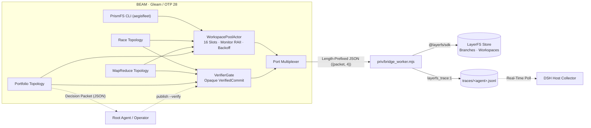

# PrismFS

[English](README.md) | [简体中文](README.zh-CN.md)

> **Refract one intent into $N$ parallel LayerFS branches on the BEAM, and focus the verified winner back to `main`.**

**PrismFS** (`aegisfleet`) is a deterministic, fault-tolerant multi-agent fleet control plane written in **Gleam (Erlang/OTP 28)** on top of **[LayerFS](layerfs)**.

It replaces fragile, prompt-driven shell orchestration (`mount → exec → commit → unmount` loops and manual workspace garbage collection) with a strongly-typed OTP supervision and scheduling kernel:
- **Process-bound RAII Workspace Leases**: Automatic `unmount(discard: true)` when an agent worker crashes, times out, or is preempted.
- **Compile-Time Verification Gate**: Opaque `UnverifiedCommit` and `VerifiedCommit` types guarantee at compile time that untested code can never be published to `main`.
- **Deterministic Fleet Topologies**: First-class `Race` (latency hedging with sub-millisecond preemption), `MapReduce` (parallel sharded execution with automated 3-way merge), and `Portfolio` (exhaustive multi-strategy evaluation).
- **Main-Agent Sovereignty**: Topologies never mutate `main` behind the caller's back. They emit structured decision packets so the root agent (or human operator) retains final authority via CAS-guarded `publish`.

---

## Documentation

- **[Architecture & Engineering Design (`docs/DESIGN.md`)](docs/DESIGN.md)**: System architecture, OTP actor state machines, opaque type gates, and zero-intrusion DSH runtime integration.
- **[User Acceptance Testing (`docs/UAT.md`)](docs/UAT.md)**: 24 automated end-to-end acceptance checks (`./scripts/uat.sh`) and 11 kernel unit tests.
- **[Scope & Boundaries (`docs/NOT_IMPLEMENTED.md`)](docs/NOT_IMPLEMENTED.md)**: Explicit list of unimplemented features, unverified backends, and non-goals.

---

## Architecture



---

## Key Capabilities

### 1. Multiplexed Port Bridge (`aegis/bridge`)
`priv/bridge_worker.mjs` runs as a long-lived Node.js sidecar managed via an Erlang `{packet, 4}` Port (4-byte big-endian length prefix + UTF-8 JSON payload).
- Multiplexes concurrent requests by `id` so long-running `exec` calls never block `mount`, `commit`, or `unmount` operations from sibling workers.
- Preserves structured LayerFS error codes (`Busy`, `Conflict`, `HeadMoved`, `Capacity`) for deterministic handling on the BEAM side.
- Emits native `layerfs_trace:1` JSONL streams per worker and mirrors named agent events to `DSH_LAYERFS_TRACE` when running inside DeepSeek Harness (DSH).

### 2. 16-Slot RAII Workspace Pool (`aegis/workspace_pool`)

| Condition | Kernel Behavior |
| :--- | :--- |
| **All 16 slots in use** | Checkouts enter a FIFO queue with per-waiter deadline (`QueueTimeout`). |
| **`Busy` / `Capacity` refusal** | Slot remains reserved; retries automatically with exponential backoff (`200ms → 400ms → 800ms…`, capped at `5s`). |
| **Worker crash or preemption** | Dedicated watcher receives Erlang `DOWN` signal $\rightarrow$ triggers `unmount(path, discard: true)` $\rightarrow$ reclaims slot immediately. |
| **Worker killed while mount in flight** | Lease is marked `released`; as soon as the in-flight mount resolves, it is immediately unmounted and discarded. |
| **Orphaned mounts** | `reap` inspects all sandbox workspaces and safely unmounts only `Idle` workspaces with zero uncommitted overlay changes. |
| **Stale lease TTL** | Periodic sweep reclaims active leases exceeding `lease_ttl_ms`. |

### 3. Compile-Time Verification Gate (`aegis/domain/layer`)
- Worker execution produces only an opaque `UnverifiedCommit`.
- The constructor for `VerifiedCommit` is private to `aegis/domain/layer` and can only be instantiated by `verify()` when the verifier command exits with `0` inside a clean, isolated Workspace.
- `layer.publish()` accepts only `VerifiedCommit`—passing an `UnverifiedCommit` is a compile-time type error (verified continuously via `./scripts/prove_opaque.sh`).

### 4. Fleet Topologies (`Race` · `MapReduce` · `Portfolio`)

| Topology | Purpose | Termination Condition | Loser / Intermediate Handling |
| :--- | :--- | :--- | :--- |
| **`Race`** | Latency hedging across equivalent attempts | First candidate to pass `VerifierGate` | Remaining workers are killed in `<1ms`; uncommitted workspace state is discarded. |
| **`MapReduce`** | Parallel execution across orthogonal shards | All shards pass individual verification, merge cleanly, and pass post-merge verification | Shard branches are preserved; merge conflicts abort cleanly with `MergeFailed`. |
| **`Portfolio`** | Exhaustive evaluation of distinct designs | All candidates finish execution and verification | No early kills; emits a full comparison table and machine-readable `[packet]` JSON. |

### 5. Two-Phase Decision & CAS-Guarded Publish
No topology modifies `main` by default:
1. **Phase 1 (Explore & Verify)**: Run `portfolio`, `race`, or `map-reduce` to evaluate candidates and receive a structured `[packet]` containing branch names, commit IDs, changed file lists, verification latency, and test output.
2. **Phase 2 (Decide & Publish)**: The root agent runs `publish <branch> --verify "<cmd>"`, which re-verifies the branch's current head in a fresh workspace, verifies that the branch head did not move during verification (CAS guard), and publishes that exact commit ID to `main`.

---

## Quick Start

### Prerequisites
- **Erlang/OTP** $\ge$ 28
- **Gleam** $\ge$ 1.14
- **Node.js** $\ge$ 22
- **LayerFS** checkout linked at [`./layerfs`](layerfs) (or specified via `LAYERFS_DIR`)

### Build & Verify

```bash
# 1. Build standalone escript executable (./aegisfleet)
./scripts/build.sh

# 2. Run the 11 kernel unit tests against the LayerFS simulator
./scripts/test.sh

# 3. Run the 24-case automated UAT suite
./scripts/uat.sh

# 4. Run interactive topology demos
./scripts/demo.sh
./aegisfleet demo-map-reduce priv/fixture_mr
./scripts/prove_opaque.sh
```

### CLI Reference

```text
usage:
  aegisfleet status                          project, Branches and mounted Workspaces
  aegisfleet reap                            unmount every idle, clean Workspace
  aegisfleet race [--publish] --verify "<cmd>" <name>:<command> ...
                                             hedge: first verified Branch wins
  aegisfleet map-reduce [--publish] --verify "<cmd>" <name>:<command> ...
                                             parallel shards, merged and verified
  aegisfleet portfolio --verify "<cmd>" <name>:<command> ...
                                             evaluate every approach; never publishes
  aegisfleet publish <branch> --verify "<cmd>"
                                             re-verify with CAS head check and publish to main
  aegisfleet run <branch> "<command>" [--verify "<cmd>"]
                                             one leased Workspace, one Commit
```

### DeepSeek Harness (DSH) Integration

When linked into LayerFS (`layerfs/fleet -> PrismFS`), `@dsh-layerfs/host` automatically injects `DSH_LAYERFS_FLEET` and routes `lfs.js fleet` commands to PrismFS while streaming per-worker traces to the DSH Web UI:

```bash
node "$DSH_LAYERFS_CLI" fleet portfolio --verify "npm test" \
  fast:"node try_fast.js" \
  safe:"node try_safe.js"

# After inspecting the decision packet:
node "$DSH_LAYERFS_CLI" fleet publish pf-safe --verify "npm test"
```

---

## Repository Layout

```text
PrismFS/
├── gleam.toml                        # Gleam package & OTP dependency manifest
├── layerfs -> ../layerfs             # Symlink to LayerFS repository
├── priv/
│   ├── bridge_worker.mjs             # Long-lived Node.js SDK bridge & trace mirror
│   ├── fixture/                      # Race topology fixture
│   ├── fixture_mr/                   # MapReduce topology fixture
│   └── fixture_portfolio/            # Portfolio topology fixture
├── src/
│   ├── aegisfleet.gleam              # Escript entry point
│   ├── aegis_native.erl              # Erlang FFI (Port, env, argv, priv_dir)
│   └── aegis/
│       ├── config.gleam              # Environment & DSH_LAYERFS_* configuration loader
│       ├── bridge.gleam              # Multiplexed Erlang Port client
│       ├── sdk.gleam                 # Typed LayerFS operations & JSON decoders
│       ├── workspace_pool.gleam      # 16-slot RAII lease pool, watcher & backoff
│       ├── worker_runner.gleam       # Checkout -> exec -> commit lifecycle
│       ├── verifier_gate.gleam       # Isolated verification workspace runner
│       ├── cli.gleam                 # CLI command dispatcher & CAS publisher
│       ├── domain/
│       │   ├── layer.gleam           # Opaque UnverifiedCommit / VerifiedCommit types
│       │   └── plan.gleam            # Candidate / Shard / FleetPlan ADTs
│       └── topologies/
│           ├── race.gleam            # Preemptive latency-hedging coordinator
│           ├── map_reduce.gleam      # Sharded execution & 3-way fold merger
│           └── portfolio.gleam       # Exhaustive multi-candidate evaluator
├── docs/
│   ├── DESIGN.md                     # Architecture & engineering specification
│   ├── UAT.md                        # User acceptance test plan & report
│   └── NOT_IMPLEMENTED.md            # Known limitations & roadmap boundaries
├── integration/
│   ├── lfs-fleet.patch               # Patch for @dsh-layerfs/host lfs.js
│   └── lfs.js                        # Patched lfs.js reference
├── test/                             # Gleeunit kernel test suite
├── verify/                           # Bridge & DSH Collector contract verifiers
└── scripts/                          # Build, test, demo, and UAT automation scripts
```

---

## License

Apache-2.0
