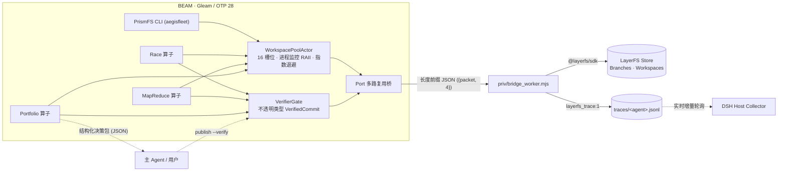

# PrismFS

[English](README.md) | [简体中文](README.zh-CN.md)

> **将单条主干意图折射为 BEAM 上的 $N$ 条并行 LayerFS 分支，并将通过验证的胜出方案重新聚焦回 `main`。**

**PrismFS**（内核包名 `aegisfleet`）是一个基于 **Gleam (Erlang/OTP 28)** 构建、运行于 **[LayerFS](layerfs)** 之上的确定性多 Agent 舰队并发控制面（Deterministic Fleet Control Plane）。

它将原本交由大模型在 Bash 中手写内联脚本维护的流程替换为确定性控制内核：
- **进程级 Workspace 租约（Workspace Pool）**：Worker 崩溃、超时或被抢占时触发 `unmount(discard: true)`；只有底层明确确认成功后才归还槽位。
- **不可变快照验证门禁（Opaque Verification Gate）**：opaque type 禁止把 `UnverifiedCommit` 传给 `layer.publish`；门禁验证精确 Commit ID，最终发布校验候选/源分支 Head 的 LayerFS CAS；`main` 的并发覆盖策略保持不变。
- **三大确定性拓扑算子**：内置 **`Race`**（BEAM Worker 终止并确认清理）、**`MapReduce`**（正交分片并行施工与三方自动合并）、以及 **`Portfolio`**（多实现方案全量评估与比选）。Worker 终止不保证 OS 或远端请求一定取消。
- **主 Agent 决策主权（Main-Agent Sovereignty）**：所有拓扑默认均不擅自修改 `main`，而是向主 Agent 输出包含分支、Commit、改动文件列表与测试耗时的结构化决策包（Decision Packet），由主 Agent 或用户拍板后通过显式 `publish` 发布。

---

## 核心文档导航

- **[架构与工程设计文档 (`docs/DESIGN.md`)](docs/DESIGN.md)**：三明治总体架构、OTP 状态机设计、Opaque Type 门禁与 DSH Runtime 无痛接入方案。
- **[大规模多 Agent 并行实现规格书 (`docs/AGENT_FLEET_SPEC.md`)](docs/AGENT_FLEET_SPEC.md)**：按正交文件边界拆分的 5 大工作包（`Workpacks A ~ E`）契约与 DSH 主 Agent 一键启动 Prompt。
- **[验收测试报告 (`docs/UAT.md`)](docs/UAT.md)**：30 项端到端自动化验收测试（`./scripts/uat.sh`）与 19 项内核单元测试明细（**30/30 PASS**）。
- **[未实现与边界说明 (`docs/NOT_IMPLEMENTED.md`)](docs/NOT_IMPLEMENTED.md)**：当前未实现能力、未验证环境边界及后续演进路线。

---

## 系统架构



---

## 核心机制

### 1. 多路复用 Port 桥接器 (`aegis/bridge`)
`priv/bridge_worker.mjs` 作为受控于 Erlang `{packet, 4}` Port 的常驻 Node.js 进程运行（采用 4 字节大端序长度前缀 + UTF-8 JSON 帧协议）：
- 按请求 `id` 全异步多路复用，慢速的 `exec` 命令绝不会阻塞其他并发分支的 `mount`、`commit` 或 `unmount`。
- 完整保留 LayerFS 底层错误码（`Busy`、`Conflict`、`HeadMoved`、`Capacity`），交由 BEAM 状态机执行确定性退避或回滚。
- 按 Worker 独立落盘 `layerfs_trace:1` 轨迹文件，并在 DeepSeek Harness (DSH) 会话中自动将具名子 Agent 事件镜像投射至前端 `Work` 与 `History` 视图。

### 2. 16 槽位 RAII 工作区池 (`aegis/workspace_pool`)

| 运行场景 | 内核确定性行为 |
| :--- | :--- |
| **16 槽位已满** | `checkout` 请求进入 FIFO 队列等待，每个排队请求拥有独立超时保护（`QueueTimeout`）。 |
| **`Busy` / `Capacity` 瞬时拒绝** | 保持槽位预留，自动按指数退避策略（`200ms → 400ms → 800ms…`，上限 `5s`）重试挂载。 |
| **Worker 崩溃或被抢占终止** | 独立 Watcher 收到 Erlang `DOWN` 后请求 `unmount(path, discard: true)`；确认成功后才归还槽位。 |
| **Mount 飞行途中 Worker 死亡** | 租约标记为 `released`；待底层 `mount` 返回后请求卸载并丢弃，确认成功后才释放所有权。 |
| **Mount/Unmount 结果未知** | 保留槽位、Owner、路径/意图（若已知）及错误并隔离；不对不确定操作并发重试。 |
| **关闭** | Drain 停止接单、拒绝队列并等待晚到回复与卸载重试；超时显式报告未清理资源。 |
| **异常残留挂载清理** | `reap` 命令自动巡检并仅卸载处于 `Idle` 状态且无未提交改动的安全挂载点。 |
| **长时挂死租约回收** | 周期性触发 `Sweep` 扫描，强制回收超过 `lease_ttl_ms` 的僵尸租约。 |

### 3. 编译期验证门禁 (`aegis/domain/layer`)
- 任何 Worker 执行命令仅能产出 `UnverifiedCommit`。
- `VerifiedCommit` 的构造器为模块私有。`VerifierGate` 从候选的不可变 Commit ID 创建私有 `verify-*` Branch 后执行验证；旧版 SDK 没有安全删除原语，因此这些证明 Branch 会保留。
- `layer.verify` 信任调用方提供的执行证据；opaque type 只阻止错误结果类型进入 `publish`，不会独立认证任意证据。
- `layer.publish()` 仅接受 `VerifiedCommit`；传入 `UnverifiedCommit` 会产生编译错误，并由 `./scripts/prove_opaque.sh` 检查。该证明只覆盖进程内 API 路径，不代表任意 SDK 调用或 daemon/进程故障都能被内核兜底。

### 4. 三大并发拓扑算子 (`Race` · `MapReduce` · `Portfolio`)

| 算子 | 适用场景 | 终止条件 | 失败/慢分支处理策略 |
| :--- | :--- | :--- | :--- |
| **`Race`** | 同一目标的等价竞速尝试（对冲长尾延迟） | 第一个通过 `VerifierGate` 的分支诞生 | 其余 BEAM Worker 被终止；未提交工作区在确认卸载后丢弃，已提交历史保留；不保证 OS 或远端请求取消。 |
| **`MapReduce`** | 正交模块分片并行重构与合流 | 所有分片各自过检 $\rightarrow$ 折叠合并 $\rightarrow$ 合并分支再次过检 | 保留各分片分支；若发生三方合并冲突则安全中止并返回 `MergeFailed`。 |
| **`Portfolio`** | 不同实现方案的全量对比评估 | 所有候选方案均完成执行与验证 | 不提前强杀任何分支；输出完整对比报表与机器可读的 `[packet]` JSON 决策包。 |

### 5. 两阶段决策与候选 Head CAS 发布
内核默认绝不自动改写 `main`：
1. **第一阶段（并发探索与验证）**：主 Agent 调用 `portfolio`、`race` 或 `map-reduce`，获取包含各候选分支、Commit ID、改动文件列表、验证耗时及测试输出的结构化 `[packet]`。
2. **第二阶段（拍板与受控发布）**：主 Agent 选定最优分支后调用 `publish <branch> --verify "<cmd>"`。内核在全新工作区中对该分支当前 Head 重新运行验证，并在发布前校验候选/源分支 Head 在验证期间未发生移动（CAS 保护），确认无误后将其发布至 `main`；`main` 的并发覆盖策略保持不变。

---

## 快速开始

### 环境依赖
- **Erlang/OTP** $\ge$ 28
- **Gleam** $\ge$ 1.14
- **Node.js** $\ge$ 22.19
- **LayerFS**：使用 [`layerfs.revision`](layerfs.revision) 记录的固定兼容版本

### 构建与验证

```bash
# 拉取兼容的旧版 simulator SDK 并安装其 workspace 依赖。
# 可用 LAYERFS_DIR 指向独立 checkout；脚本不会移动已有 checkout。
./scripts/bootstrap-layerfs.sh

# 1. 编译生成独立可执行文件 (./aegisfleet)
./scripts/build.sh

# 2. 运行 19 项内核单元测试（基于真实 LayerFS 模拟器）
./scripts/test.sh

# 3. 运行 30 项端到端自动化验收测试 (UAT)
./scripts/uat.sh

# 4. 运行各拓扑端到端演示与编译期门禁证明
./scripts/demo.sh
./aegisfleet demo-map-reduce priv/fixture_mr
./scripts/prove_opaque.sh
```

`scripts/env.sh` 会在执行前校验 LayerFS 的精确 revision。新版 LayerFS
`main` 已改用 Workspace API，本项目会明确拒绝而不是静默调用不兼容的旧版
`sandbox.mount/exec/commit/unmount`。不可取消的 SDK 调用可能延迟优雅 drain；
强杀恢复以及 daemon/bridge 进程死亡后的资源恢复不在当前保证范围内。

### CLI 命令速查

```text
usage:
  aegisfleet status                          查看项目、分支列表与当前挂载的工作区
  aegisfleet reap                            安全卸载所有处于 Idle 且干净的残留工作区
  aegisfleet race [--publish] --verify "<cmd>" <name>:<command> ...
                                             赛马模式：第一个通过验证的分支胜出并终止其余 BEAM Worker、请求清理
  aegisfleet map-reduce [--publish] --verify "<cmd>" <name>:<command> ...
                                             分治模式：多分支并行施工、折叠合并并统一验证
  aegisfleet portfolio --verify "<cmd>" <name>:<command> ...
                                             比选模式：全量评估所有候选方案并输出决策包（绝不自动发布）
  aegisfleet publish <branch> --verify "<cmd>"
                                             主 Agent 决策发布：重新验证 + Head CAS 校验后更新 main
  aegisfleet run <branch> "<command>" [--verify "<cmd>"]
                                             单步受管执行：自动分配租约、提交并卸载工作区
```

### 在 DeepSeek Harness (DSH) 中使用

通过 [`layerfs/fleet -> PrismFS`](layerfs) 软链接挂载后，`@dsh-layerfs/host` 会自动注入 `DSH_LAYERFS_FLEET` 并将 `lfs.js fleet` 路由至 PrismFS，同时将各并发 Worker 的执行轨迹实时渲染至 DSH Web 的 `Work` 与 `History` 面板：

```bash
# 并发评估两种实现方案
node "$DSH_LAYERFS_CLI" fleet portfolio --verify "npm test" \
  fast:"node try_fast.js" \
  safe:"node try_safe.js"

# 主 Agent 根据决策包选择分支并正式发布至 main
node "$DSH_LAYERFS_CLI" fleet publish pf-safe --verify "npm test"
```

---

## 工程目录结构

```text
PrismFS/
├── gleam.toml                        # Gleam 项目配置与 OTP 依赖声明
├── layerfs -> ../layerfs             # 指向底层 LayerFS 仓库的软链接
├── priv/
│   ├── bridge_worker.mjs             # 常驻 Node.js SDK 桥接进程与 DSH Trace 镜像器
│   ├── fixture/                      # Race 拓扑测试与演示工程
│   ├── fixture_mr/                   # MapReduce 拓扑测试与演示工程
│   └── fixture_portfolio/            # Portfolio 拓扑测试与演示工程
├── src/
│   ├── aegisfleet.gleam              # Escript 可执行程序入口
│   ├── aegis_native.erl              # Erlang FFI 底层原语 (Port / env / argv / priv_dir)
│   └── aegis/
│       ├── config.gleam              # 环境变量与 DSH_LAYERFS_* 自适应配置加载器
│       ├── bridge.gleam              # 多路复用 Erlang Port 客户端
│       ├── sdk.gleam                 # 强类型 LayerFS SDK 调用封装与 JSON 解码器
│       ├── workspace_pool.gleam      # 16 槽位 RAII 工作区租约池、进程监控与退避重试
│       ├── worker_runner.gleam       # 单分支 checkout -> exec -> commit 执行器
│       ├── verifier_gate.gleam       # 独立验证沙箱门禁执行器
│       ├── cli.gleam                 # CLI 命令分发与 CAS 安全发布逻辑
│       ├── domain/
│       │   ├── layer.gleam           # UnverifiedCommit / VerifiedCommit 不透明类型定义
│       │   └── plan.gleam            # Candidate / Shard / FleetPlan 代数数据类型
│       └── topologies/
│           ├── race.gleam            # 赛马抢占并发控制器
│           ├── map_reduce.gleam      # 分治执行与三方折叠合并控制器
│           └── portfolio.gleam       # 多方案全量评估与决策包生成器
├── docs/
│   ├── DESIGN.md                     # 架构与工程设计文档
│   ├── UAT.md                        # 30 项自动化验收测试规范与报告
│   └── NOT_IMPLEMENTED.md            # 未实现能力与系统边界说明
├── integration/
│   ├── lfs-fleet.patch               # @dsh-layerfs/host lfs.js 集成补丁
│   └── lfs.js                        # 打补丁后的完整 lfs.js 参考实现
├── test/                             # Gleeunit 内核单元测试套件
├── verify/                           # Bridge 协议与 DSH Collector 契约验证脚本
└── scripts/                          # 构建、测试、演示与 UAT 一键自动化脚本
```

---

## 开源许可

Apache-2.0
