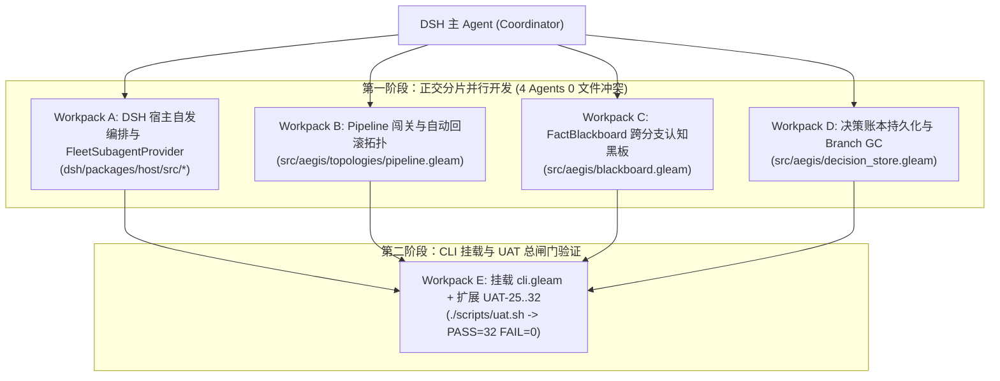

# PrismFS 大规模多 Agent 并行实现工程规格书（Agent Fleet Implementation Playbook）

> **文档目的**：本文档是一份**面向 DSH 主 Agent 及其并发子 Agent 舰队的可执行工程规格书（Executable Specification）**。
> 所有待实现特性均已按**正交文件边界（Orthogonal File Boundaries）**拆分为 **5 个零冲突工作包（Workpacks A ~ E）**，每个工作包均定义了精确的输入契约、类型签名、状态机逻辑与自动化验收命令（UAT）。

---

## 1. 全局约束与并行分片原则（Global Invariants）

在启动多 Agent 并行开发前，所有 Agent 必须遵守以下硬性工程约束：

1. **零回归基线**：现有 24 项自动化验收测试（`./scripts/uat.sh` $\rightarrow$ `PASS=24 FAIL=0`）与 11 项内核单元测试（`./scripts/test.sh`）必须始终保持 100% 通过。
2. **编译期门禁不可绕过**：`aegis/domain/layer.gleam` 中的 `UnverifiedCommit` 与 `VerifiedCommit` 不透明类型边界严禁削弱；任何写入 `main` 的路径必须持有 `VerifiedCommit`。
3. **正交文件锁（防止多 Agent 合并冲突）**：
   - **Workpack A / B / C / D** 分别操作完全独立的新增模块文件，**禁止在阶段一修改公共路由文件 `src/aegis/cli.gleam` 和 `scripts/uat.sh`**；
   - 待 Workpack A ~ D 各自通过独立 `gleam test` 后，由 **Workpack E（集成 Agent）** 统一挂载进 `src/aegis/cli.gleam` 与 `scripts/uat.sh`。



---

## 2. Workpack A：DSH 宿主自发调用与 `FleetSubagentProvider`（关闭 G-01 / G-02 / G-03 / G-05）

### 2.1 目标与职责
让 DSH 中的 Agent **无需用户手动提示 `fleet`** 即可自发使用 PrismFS 拓扑算子，并将 DSH 原生的 `subagent` 工具接入 PrismFS 的分支与 16 槽位租约管理。

### 2.2 允许修改与新增的文件范围
- 修改：`/Users/huangzhenyu/Projects/layerfs/dsh/packages/host/src/env.js`
- 修改：`/Users/huangzhenyu/Projects/layerfs/dsh/packages/host/src/lfs.js`
- 修改：`/Users/huangzhenyu/Projects/layerfs/dsh/packages/host/src/index.js`
- 修改：`/Users/huangzhenyu/Projects/layerfs/dsh/packages/dsh-layerfs/presets/layerfs-dsh-minimalist.patch.yml`
- 新增：`/Users/huangzhenyu/Projects/layerfs/dsh/packages/host/src/fleet-provider.js`

### 2.3 详细实现规范

#### (1) `env.js`：动态注入自发编排上下文（`projectContext`）
在 [`env.js`](file:///Users/huangzhenyu/Projects/layerfs/dsh/packages/host/src/env.js#L43-L49) 的 `projectContext(bindings, collector, session)` 中，当会话绑定了 LayerFS 项目且 `fleetBin` 存在时，返回包含完整自发触发规则的上下文文本：

```javascript
export function projectContext(bindings, collector, session) {
  if (!session) return "";
  const agent = collector.agentOf(session);
  const project = bindings.projectFor(agent.root, agent.cwd);
  if (!project) return "";
  const mode = isSim(project) ? "simulated" : "live";
  if (!fleetBin) {
    return `LayerFS project of this conversation: ${project.name} (${mode}). Every bash call has it as DSH_LAYERFS_PROJECT; work on it through the LayerFS SDK.`;
  }
  return [
    `LayerFS project of this conversation: ${project.name} (${mode}, managed by PrismFS fleet control plane).`,
    `Every bash call has DSH_LAYERFS_PROJECT, DSH_LAYERFS_CLI, and DSH_LAYERFS_FLEET.`,
    `Rules for autonomous execution (` + "`main`" + ` is read-only; never write to main directly):`,
    `1. Inspect state: node "$DSH_LAYERFS_CLI" status | ls|cat|grep <ref> <path> | diff <a> <b>`,
    `2. Multiple design options / uncertain approach -> Spontaneously run Portfolio:`,
    `   node "$DSH_LAYERFS_CLI" fleet portfolio --verify "<test_cmd>" <name1>:"<bash1>" <name2>:"<bash2>"`,
    `3. Orthogonal modules/files to modify in parallel -> Spontaneously run MapReduce:`,
    `   node "$DSH_LAYERFS_CLI" fleet map-reduce --verify "<test_cmd>" <shard1>:"<bash1>" <shard2>:"<bash2>"`,
    `4. Equivalent attempts racing for first passing check -> Spontaneously run Race:`,
    `   node "$DSH_LAYERFS_CLI" fleet race --verify "<test_cmd>" <cand1>:"<bash1>" <cand2>:"<bash2>"`,
    `5. Single branch step with automatic 16-slot lease & crash-safe unmount:`,
    `   node "$DSH_LAYERFS_CLI" fleet run <branch> "<bash>" [--verify "<test_cmd>"]`,
    `6. Publish verified branch to main (re-verifies with CAS head guard):`,
    `   node "$DSH_LAYERFS_CLI" fleet publish <branch> --verify "<test_cmd>"`,
    `7. Reclaim idle leftover mounts: node "$DSH_LAYERFS_CLI" fleet reap`,
  ].join("\n");
}
```

#### (2) `lfs.js`：顶层命令直达别名
在 [`lfs.js`](file:///Users/huangzhenyu/Projects/layerfs/dsh/packages/host/src/lfs.js#L81-L146) 中，除保留 `lfs.js fleet <subcmd> ...` 外，将 `portfolio`、`race`、`map-reduce`、`publish`、`reap` 注册为 `commands` 的顶层键（内部直接调用 `runFleet([cmd, ...args])`），消除 Agent 漏写 `fleet` 前缀导致的报错。

#### (3) `fleet-provider.js`：原生 Subagent 隔离与生命周期托管
对接 `@deepseek-ai/dsh-subagent`（参见 [`packages/subagent/subagent/src/index.ts`](file:///Users/huangzhenyu/Projects/deepseek-harness/packages/subagent/subagent/src/index.ts#L194-L200)）：
1. **启动前（Pre-hook）**：当主 Agent 调用 `subagent` 工具时，自动为子 Agent 生成唯一分支名 `sub-<shortId>`，调用 `aegisfleet`（或 `bridge_worker.mjs`）从当前基线 `fork` 该分支，并在 `bindings.json` 中登记 `childSessionId -> { root: rootSessionId, name: label }`；
2. **执行中（In-flight）**：向子 Agent 的会话上下文注入专属工作分支名 `sub-<shortId>`，使其所有修改天然落入独立分支；
3. **结束/中断后（Post-hook & AbortSignal）**：监听 `request.signal`（用户点击 Stop 或超时），自动触发 `fleet reap` 回收残留挂载；子 Agent 正常结束时，自动计算 `diff("main", "sub-<shortId>")` 并附加到返回给主 Agent 的结果摘要中，**绝不自动 publish**。

### 2.4 Workpack A 独立验收标准
```bash
# 1. 验证顶层别名与 fleet 子命令一致
DSH_LAYERFS_PROJECT="fleet-playground" \
DSH_LAYERFS_HOME="/private/var/folders/8z/lzgyz29n0gb9xtxs35yzmtw80000gn/T/dsh-layerfs/home" \
DSH_LAYERFS_SDK="/Users/huangzhenyu/Projects/layerfs/dsh/packages/host/src/sim/sdk.js" \
DSH_LAYERFS_DOCKER="sim" \
node /Users/huangzhenyu/Projects/layerfs/dsh/packages/host/src/lfs.js reap
```

---

## 3. Workpack B：`Pipeline` 多阶段闯关与自动回滚拓扑（关闭 G-06）

### 3.1 目标与职责
实现设计文档中的第三大拓扑算子 **`Pipeline`**：支持“Stage 1（如生成测试）$\rightarrow$ Stage 2（编写实现）$\rightarrow$ Stage 3（静态检查与压测）”的顺序闯关状态机；**每个阶段拥有独立的验证门禁（`verifier`），任意阶段失败时自动回滚至上一阶段已验证通过的干净 Commit 重试（最多 `max_retries_per_stage` 次）**。

### 3.2 允许修改与新增的文件范围
- 新增：`/Users/huangzhenyu/Projects/PrismFS/src/aegis/topologies/pipeline.gleam`
- 新增：`/Users/huangzhenyu/Projects/PrismFS/test/pipeline_test.gleam`
- （可选扩展类型）：`/Users/huangzhenyu/Projects/PrismFS/src/aegis/domain/plan.gleam`

### 3.3 类型签名与状态机契约 (`src/aegis/topologies/pipeline.gleam`)

```gleam
import aegis/bridge
import aegis/domain/layer
import aegis/workspace_pool
import gleam/erlang/process

pub type Stage {
  Stage(
    name: String,
    command: String,
    verifier: String,
  )
}

pub type PipelineOpts {
  PipelineOpts(
    base: String,
    branch_prefix: String,
    stages: List(Stage),
    max_retries_per_stage: Int,
    publish: Bool,
    timeout_ms: Int,
    queue_timeout: Int,
    exec_timeout: Int,
    call_timeout: Int,
  )
}

pub type StageRecord {
  StageRecord(
    name: String,
    branch: String,
    attempts: Int,
    verified: layer.VerifiedCommit,
  )
}

pub type PipelineOutcome {
  Completed(
    final: layer.VerifiedCommit,
    history: List(StageRecord),
    retries_used: Int,
    published: Bool,
    total_ms: Int,
  )
  StageFailed(
    stage_name: String,
    attempts: Int,
    last_reason: String,
    completed_stages: List(StageRecord),
  )
}

pub fn run(
  bridge: bridge.Bridge,
  pool: process.Subject(workspace_pool.Msg),
  opts: PipelineOpts,
) -> Result(PipelineOutcome, String)
```

#### 状态转移与回滚规则（Rollback Mechanics）
1. **初始基线**：Stage 1 的父引用 `from_ref` 为 `opts.base`（通常为 `"main"`）。
2. **单步尝试（Attempt $k \in [1 .. \text{max\_retries} + 1]$）**：
   - 为当前尝试派生干净分支：`<branch_prefix>-<stage.name>-try-<k>`，其 `from` 严格指向**上一阶段产出的 `layer.verified_commit_id(prev_verified)`**（若为 Stage 1 则指向 `opts.base`）！
   - 这保证了：**一旦第 $k$ 次尝试改坏了文件或验证失败，第 $k+1$ 次尝试直接从上一阶段的干净快照重新 `fork`，100% 物理回滚脏状态！**
3. **门禁晋升**：当前 Stage 通过 `verifier_gate.verify` 拿到 `Ok(verified)` 后，记录 `StageRecord`，并将 `verified` 的 Commit ID 作为下一 Stage 的 `from_ref`。
4. **最终输出**：所有 Stage 通过后返回 `Completed(...)`，默认 `publish: False`（除非显式指定 `--publish`）。

### 3.4 Workpack B 独立验收标准 (`test/pipeline_test.gleam`)
1. `pipeline_three_stages_succeed_test`：Stage 1 写 `a.txt` $\rightarrow$ Stage 2 追加 `b.txt` $\rightarrow$ Stage 3 汇总校验，最终产出含两阶段成果的 `VerifiedCommit`，且 `main` 未被自动修改。
2. `pipeline_stage_retry_rolls_back_dirty_writes_test`：Stage 2 第 1 次尝试故意写入脏文件并令验证失败，第 2 次尝试写入正确内容并通过验证；断言最终分支中**不包含**第 1 次失败尝试遗留的脏文件（证明真正回滚到了 Stage 1 的干净快照）。
3. `pipeline_exhausted_retries_halts_cleanly_test`：超过 `max_retries_per_stage` 后返回 `StageFailed`，且 `in_use == 0`（无残留 Workspace）。

---

## 4. Workpack C：`FactBlackboardActor` 跨分支认知共享黑板（关闭 G-07）

### 4.1 目标与职责
实现「**文件系统严格隔离，认知经验实时互通**」：当并发分支（`Race` / `Portfolio` / `MapReduce`）中的某个 Worker 发现环境事实或踩坑预警时，通过 BEAM Actor 实时记录并注入给同批次或后续执行的 Worker，避免多个分支重复踩同一个坑。

### 4.2 允许修改与新增的文件范围
- 新增：`/Users/huangzhenyu/Projects/PrismFS/src/aegis/blackboard.gleam`
- 新增：`/Users/huangzhenyu/Projects/PrismFS/test/blackboard_test.gleam`

### 4.3 类型签名与协议契约 (`src/aegis/blackboard.gleam`)

```gleam
import gleam/erlang/process

pub type EntryKind {
  /// 环境事实发现（如："API endpoint moved to /v2/login"）
  FactDiscovered(topic: String, detail: String)
  /// 踩坑预警（如："npm run build needs NODE_OPTIONS=--max-old-space-size=4096"）
  PitfallWarning(command: String, reason: String)
  /// MapReduce 跨分片接口契约锁定（如："src/types.ts: export interface User { id: string }"）
  InterfaceLocked(path: String, signature: String)
}

pub type Entry {
  Entry(
    seq: Int,
    author: String,
    branch: String,
    kind: EntryKind,
    at_ms: Int,
  )
}

pub type Msg {
  Post(author: String, branch: String, kind: EntryKind)
  Subscribe(subscriber: process.Subject(Entry))
  Snapshot(reply: process.Subject(List(Entry)))
  ExportJson(path: String, reply: process.Subject(Result(Nil, String)))
  Stop(reply: process.Subject(Nil))
}
```

#### Shell Worker 与 LLM Subagent 消费机制
1. **实时订阅（BEAM 内部）**：任何 Actor 可调用 `blackboard.subscribe(board, subject)` 收到新发布的 `Entry`，且订阅瞬间自动重放历史已有的全部 `Entry`（History Replay）。
2. **文件/环境变量导出（供 Shell Worker 消费）**：当 Worker 启动 `exec` 前，可将当前黑板快照序列化写入 `<trace_dir>/blackboard.json`（或格式化为紧凑文本注入命令前缀），同时如果某个 Worker 在 `Race` / `Portfolio` 中命令失败退出，自动向黑板写入一条 `PitfallWarning(candidate.command, failure_reason)`！

### 4.4 Workpack C 独立验收标准 (`test/blackboard_test.gleam`)
1. `blackboard_publishes_and_replays_history_to_late_subscriber_test`：先写入 `FactDiscovered` 与 `PitfallWarning`，后注册的订阅者能按序收到全部历史条目及后续新增条目。
2. `blackboard_interface_lock_ rejects_conflicting_contract_test`（或保留首次锁定）：对同一 `path` 的 `InterfaceLocked` 提供冲突检测查询。

---

## 5. Workpack D：决策审计账本持久化与分支 GC（关闭 G-14 / G-15）

### 5.1 目标与职责
1. **关闭 G-14（决策包持久化与审计回执）**：将 `portfolio` / `race` / `map-reduce` / `pipeline` 产出的 `[packet]` 以及 `fleet publish` 的最终发布回执持久化到 `<home>/<project>/decisions/` 目录下，形成可追溯的审计链。
2. **关闭 G-15（候选分支生命周期与 GC）**：提供受控的分支清理能力（清理已废弃或未选中的 `pf-*` / `race-*` 候选分支元数据与过期决策记录）。

### 5.2 允许修改与新增的文件范围
- 新增：`/Users/huangzhenyu/Projects/PrismFS/src/aegis/decision_store.gleam`
- 新增：`/Users/huangzhenyu/Projects/PrismFS/test/decision_store_test.gleam`

### 5.3 核心接口契约 (`src/aegis/decision_store.gleam`)
1. `record_packet(home: String, project: String, kind: String, packet_json: String) -> Result(String, String)`：
   - 将拓扑评估结果写入 `<home>/decisions/<project>/latest.json` 及带单调序号的历史记录 `<home>/decisions/<project>/packet-<id>.json`。
2. `record_publish(home: String, project: String, branch: String, commit_id: String, verifier: String) -> Result(Nil, String)`：
   - 当 `fleet publish` 验证通过并成功更新 `main` 后，追加一条不可变发布审计回执（含时间戳、分支、Commit ID、验证命令）至 `<home>/decisions/<project>/receipts.jsonl`。
3. `list_receipts(home: String, project: String) -> List(Receipt)`：
   - 供 `fleet status` 或审计命令读取最近发布的决策回执。

---

## 6. Workpack E：CLI 总装与自动化 UAT 扩展（Integration Gate）

### 6.1 前置条件
必须在 **Workpack A、B、C、D 全部完成并通过各自单元测试** 后执行。

### 6.2 修改文件范围
- 修改：`/Users/huangzhenyu/Projects/PrismFS/src/aegis/cli.gleam`
- 修改：`/Users/huangzhenyu/Projects/PrismFS/scripts/uat.sh`
- 修改：`/Users/huangzhenyu/Projects/PrismFS/docs/UAT.md`
- 修改：`/Users/huangzhenyu/Projects/PrismFS/docs/NOT_IMPLEMENTED.md`

### 6.3 CLI 挂载规范 (`src/aegis/cli.gleam`)
1. 新增子命令 **`fleet pipeline [--publish] [--retries <n>] <stage>:<cmd>:<verifier> ...`**：调用 `pipeline.run` 并输出每阶段尝试次数与 `[packet]` JSON。
2. 在 `command_portfolio`、`command_race`、`command_map_reduce`、`command_pipeline` 中调用 `decision_store.record_packet` 落盘决策包。
3. 在 `publish_branch` 成功后调用 `decision_store.record_publish` 写入发布审计回执。
4. 新增子命令 **`fleet decisions`**：列出当前项目的最新决策包与历史发布回执（`receipts.jsonl`）。

### 6.4 最终总闸门验收命令
```bash
cd /Users/huangzhenyu/Projects/PrismFS
./scripts/build.sh
./scripts/test.sh     # 原有 11 项 + 新增 Pipeline / Blackboard / DecisionStore 单测全部通过
./scripts/uat.sh      # 原有 UAT-01..24 + 新增 UAT-25..32 全部 PASS, FAIL=0
```

---

## 7. 一键启动：直接复制给 DSH 主 Agent 的调度 Prompt

当你在 DSH Web (`http://127.0.0.1:3090`) 中准备让 DSH 跑大规模多 Agent 实现上述功能时，直接将以下 Prompt 发送给主 Agent 即可：

```markdown
请阅读 `/Users/huangzhenyu/Projects/PrismFS/docs/AGENT_FLEET_SPEC.md` 和 `/Users/huangzhenyu/Projects/PrismFS/docs/NOT_IMPLEMENTED.md`。

我们要按照 `docs/AGENT_FLEET_SPEC.md` 中的分片规格，使用多 Agent 并发实现剩余的核心特性（Workpack A ~ E）：

1. **第一阶段（并发分片实现，严禁越界修改文件）**：
   请同时派生 4 个独立的 `subagent` 并行执行以下 4 个正交工作包（每个 subagent 只允许修改其负责的新增文件，禁止在第一阶段修改 `src/aegis/cli.gleam` 和 `scripts/uat.sh`）：
   - **Subagent 1 (Workpack A)**：按照第 2 节改造 `/Users/huangzhenyu/Projects/layerfs/dsh/packages/host/src/env.js`、`lfs.js`、`layerfs-dsh-minimalist.patch.yml`，并实现 `fleet-provider.js`；
   - **Subagent 2 (Workpack B)**：按照第 3 节在 `/Users/huangzhenyu/Projects/PrismFS` 中实现 `src/aegis/topologies/pipeline.gleam` 与 `test/pipeline_test.gleam`（含阶段失败自动回滚至上一阶段干净 Commit 重试）；
   - **Subagent 3 (Workpack C)**：按照第 4 节实现 `src/aegis/blackboard.gleam` 与 `test/blackboard_test.gleam`（跨分支事实与踩坑预警 PubSub 黑板）；
   - **Subagent 4 (Workpack D)**：按照第 5 节实现 `src/aegis/decision_store.gleam` 与 `test/decision_store_test.gleam`（决策包与发布回执持久化）。

2. **第二阶段（总装与 UAT 全量门禁验证）**：
   等 4 个 Subagent 全部完成后，由你（主 Agent）执行 **Workpack E（第 6 节）**：
   - 将 `pipeline`、`blackboard`、`decision_store` 挂载进 `/Users/huangzhenyu/Projects/PrismFS/src/aegis/cli.gleam`；
   - 运行 `gleam format src test && ./scripts/build.sh && ./scripts/test.sh` 确保所有单测全绿；
   - 在 `scripts/uat.sh` 中补充 `UAT-25` ~ `UAT-30` 验收测试并运行 `./scripts/uat.sh`，确保 `FAIL=0`；
   - 更新 `docs/NOT_IMPLEMENTED.md` 与 `docs/UAT.md`。
```
