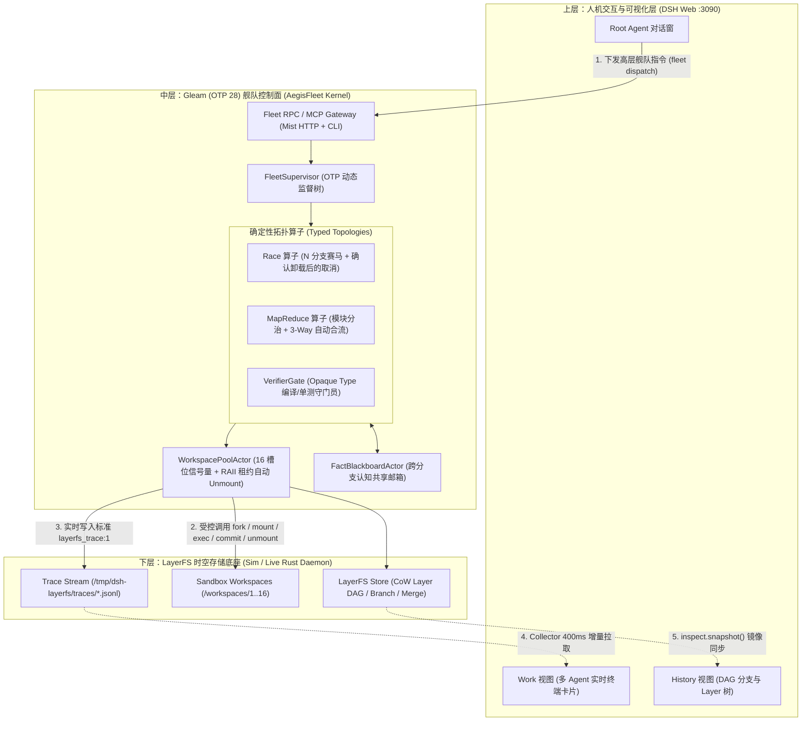
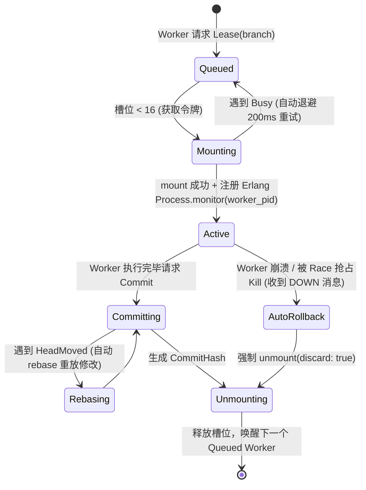
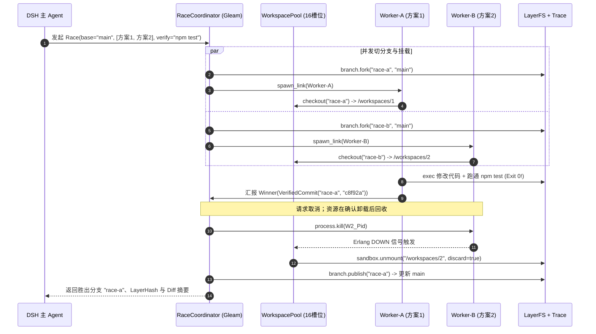
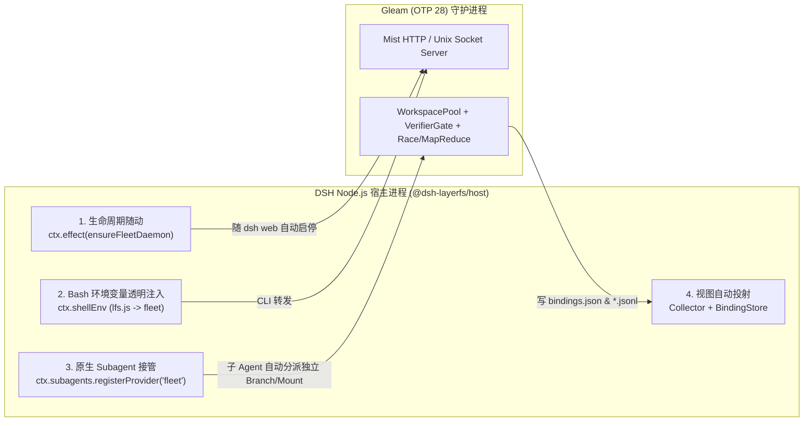

# AegisFleet：基于 Gleam (BEAM) × LayerFS × DSH 的多 Agent 舰队架构与工程设计文档

> [!IMPORTANT]
> **核心定位**：保留 **LayerFS** 的底层 CoW 分支与沙箱底座（手脚），保留 **DSH Web** 的交互对话与 DAG 实时可视化面板（眼睛），用 **Gleam (Erlang/OTP 28)** 彻底替换当前靠 75 行 System Prompt 让大模型手搓脚本的脆弱中间层，打造一个**类型安全、具备显式未知状态与排空协议的确定性多 Agent 并发控制面（Deterministic Fleet Control Plane）**。

---

## 1. 背景与现状痛点剖析（Why Now）

通过对现有 LayerFS × DSH 代码库的源码审计，当前架构存在显著的**“头重脚轻、腰部悬空”**问题：

| 层级 | 现有实现模块 | 源码审计结论 | 核心痛点与工程瓶颈 |
| :--- | :--- | :--- | :--- |
| **展示与交互层** | [`view.js`](file:///Users/huangzhenyu/Projects/layerfs/dsh/packages/view/src/view.js) / [`collector.js`](file:///Users/huangzhenyu/Projects/layerfs/dsh/packages/host/src/collector.js) | 极佳。纯原生 DOM/SVG 渲染，通过轮询 `<traceDir>/<agentId>.jsonl` 与 `inspect.snapshot()` 实时绘制多终端与分支树。 | 仅做单向观测（行车记录仪），无任何并发调度、熔断或死锁干预能力。 |
| **中间编排层（缺失）** | [`layerfs-dsh-minimalist.patch.yml`](../../layerfs/dsh/packages/dsh-layerfs/presets/layerfs-dsh-minimalist.patch.yml#L24-L99) | **几乎为零**。没有独立调度器代码，全靠一段 75 行的 System Prompt 让 LLM 在 Bash 中手写 `node <<'JS'` 脚本。 | 1. **16 槽位泄漏死锁**：子 Agent 异常中断即永久占死 Daemon 的 16 个 Workspace 槽位，需要手工卸载；<br>2. **无自动重试**：遇到 `Busy` 或 `HeadMoved` 锁冲突直接报错退出；<br>3. **无抢占与验证门禁**：Node.js `Promise.all` 无法在赛马胜出时可靠取消其余分支与子进程。 |
| **存储与沙箱底座** | [`lfs.js`](file:///Users/huangzhenyu/Projects/layerfs/dsh/packages/host/src/lfs.js) / [`sim/binding.js`](file:///Users/huangzhenyu/Projects/layerfs/dsh/packages/host/src/sim/binding.js) / Rust Crates | 极强。提供 `branch.fork`、`sandbox.mount`、`sandbox.commit`、`branch.merge`、`branch.publish` 等原子原语。 | 纯被动存储与执行引擎，不包含任务队列、租约回收或工作流状态机。 |

---

## 2. 总体架构设计（The Sandwich Architecture）

系统采用三层解耦的**“三明治架构”**：



> [!TIP]
> **零前端改造兼容**：Gleam 内核直接复用 [`collector.js`](file:///Users/huangzhenyu/Projects/layerfs/dsh/packages/host/src/collector.js#L115-L131) 识别的 `{ "layerfs_trace": 1, ... }` JSONL 协议与 [`binding.js`](file:///Users/huangzhenyu/Projects/layerfs/dsh/packages/host/src/binding.js) 的 Agent 注册表。BEAM 启动的每一个 Worker Actor 都会在 DSH Web 的 `Work` 和 `History` 面板中自动显示为具名 Agent（如 `racer-1`、`verifier-gate`）并实时播放动画！

---

## 3. 核心模块与 Gleam 类型系统设计

### 3.1 编译期防呆：基于 Opaque Types 的“验证门禁（Verifier Gate）”

在现有系统中，任何写出语法错误的子 Agent 都能将烂代码合并或发布。在 Gleam 中，我们利用 **不透明类型（Opaque Types）** 在编译期锁死主干安全性：

```gleam
// src/aegis/domain/layer.gleam

/// 原始未验证的分支提交，任何 Worker 执行完命令只产出此类型
pub opaque type UnverifiedCommit {
  UnverifiedCommit(project: String, branch: String, commit_id: String, head_layer: String)
}

/// 只有通过 VerifierGateActor 跑通编译与单测（ExitCode == 0）后，才允许构造此类型
pub opaque type VerifiedCommit {
  VerifiedCommit(
    project: String,
    branch: String,
    commit_id: String,
    head_layer: String,
    test_stdout: String,
    duration_ms: Int,
  )
}

/// 唯一能将 UnverifiedCommit 升级为 VerifiedCommit 的守门函数
pub fn verify_commit(
  pool: Subject(PoolMsg),
  candidate: UnverifiedCommit,
  check_cmd: String,
) -> Result(VerifiedCommit, VerificationError) {
  // 在只读/丢弃型 Workspace 中挂载并执行 check_cmd (例如 "cargo test" 或 "npm test")
  // 只有 exit_code == 0 才返回 Ok(VerifiedCommit(...))
}

/// 合并与发布函数在类型签名上只接受 VerifiedCommit！
/// 未经测试验证的代码在 Gleam 编译期就无法调用 publish_to_main
pub fn publish_to_main(
  bridge: LayerFsBridge,
  verified: VerifiedCommit,
) -> Result(LayerId, LayerFsError)
```

---

### 3.2 根治 16 槽位泄漏：`WorkspacePoolActor`（RAII 租约与指数退避重试）

针对 [`layerfs-dsh-minimalist.patch.yml`](file:///Users/huangzhenyu/Projects/layerfs/dsh/packages/dsh-layerfs/presets/layerfs-dsh-minimalist.patch.yml#L63-L96) 中最头疼的 **16 Workspace 容量上限**与 **Busy/HeadMoved 锁冲突**，由一个全局单例 OTP Actor 统一接管：



* **进程级生死绑定（Process Monitor RAII）**：当 Worker Actor 借出一个挂载点（如 `/workspaces/3`）时，`WorkspacePoolActor` 立即调用 `process.monitor(worker_pid)`。
* **崩溃清理**：Worker 的 `ProcessDown` 会触发 `sandbox.unmount(sb, path, discard: true)`；槽位仅在底层确认卸载后归还。超时、错误或 bridge 进程死亡会保留租约并报告未知状态。

---

### 3.3 三大确定性并发拓扑算子（Fleet Topologies）

通过 Gleam ADT 定义可嵌套组合的舰队执行计划：

```gleam
// src/aegis/topology/plan.gleam

pub type FleetPlan {
  /// 1. 赛马模式：从同一 base_ref 派生 N 个分支并发尝试不同策略，
  ///    第一个通过 verifier_cmd 的分支胜出，其余 N-1 个分支请求取消并在确认卸载后回收 Mount
  Race(
    base_ref: String,
    candidates: List(CandidateSpec),
    verifier_cmd: String,
    timeout_ms: Int,
  )

  /// 2. 分治模式：将任务拆分为 N 个正交子分支并发施工，
  ///    全部通过各自 Verifier 后，由 MergerActor 执行两两 branch.merge 归约合成
  MapReduce(
    base_ref: String,
    shards: List(ShardSpec),
    merge_verifier_cmd: String,
  )

  /// 3. 闯关流水线：Stage 1 (如写测试) -> Stage 2 (写实现) -> Stage 3 (性能压测)
  ///    任意阶段失败自动回滚至上一阶段干净 LayerHash 重试
  Pipeline(
    base_ref: String,
    stages: List(StageSpec),
    max_retries_per_stage: Int,
  )
}
```

#### 赛马抢占（Race）时序图



---

### 3.4 「文件隔离，认知互通」：`FactBlackboardActor`（跨分支黑板）

* **痛点**：5 个分支的文件系统隔离后，Agent A 耗时 30 秒发现“某配置文件路径在 `/etc/foo` 而不是 `/app/foo`”，Agent B/C 还在重复踩坑。
* **设计**：每个 Fleet 任务启动一个 `FactBlackboardActor`。Worker 可随时广播强类型事件：
  * `FactDiscovered(topic, detail)`：环境事实发现；
  * `PitfallWarning(command, reason)`：踩坑预警（例如某命令会卡死）；
  * `InterfaceLocked(file_path, signature)`：MapReduce 模式下跨模块接口契约锁定。

---

## 4. 协议与桥接设计（How Gleam Talks to LayerFS & DSH）

为了兼顾开发速度与运行性能，底层桥接采用**双模驱动（Dual-Driver Bridge）**：

| 阶段 | 通信方式 | 实现细节 | 适用场景 |
| :--- | :--- | :--- | :--- |
| **Phase 1 (MVP 快速跑通)** | **Erlang Port 长连接守护桥 (`bridge_worker.mjs`)** | Gleam 通过 BEAM 原生 `Port` 启动一个常驻 Node.js 轻量进程，基于 Stdin/Stdout Length-Prefixed JSON 帧直接调用 `@dsh-layerfs/host` 的 `simClient` 或 `@layerfs/sdk`，同时自动追加 `.jsonl` Trace。 | **立即可用（0 Rust 编译成本）**，支持本机无 Docker 的 `sim` 模拟器；Docker Live 模式仍需单独验证。 |
| **Phase 2 (纯血原生高性能)** | **Rustler NIF / Unix Socket 直连 `layerfs-daemon`** | 直接将 `/Users/huangzhenyu/Projects/layerfs/core/crates/layerfs-api` 与 `layerfs-store-service` 编译为 Erlang Rustler NIF 或通过 Unix Socket 直连 Rust Daemon。 | 生产级高吞吐压测，彻底剥离 Node.js SDK 中转。 |

### DSH Trace 实时投射规范

Gleam 的 `TraceEmitterActor` 会按 DSH [`collector.js`](file:///Users/huangzhenyu/Projects/layerfs/dsh/packages/host/src/collector.js#L114-L131) 的精确格式，向 `/tmp/dsh-layerfs/traces/<rootSessionId>-<workerName>.jsonl` 写入事件，并在 `<stateDir>/bindings.json` 中自动绑定子 Agent 名称：

```json
{"layerfs_trace":1,"id":"call-101","phase":"start","fn":"sdk","op":"sandbox.exec","args":{"sandbox":"sim","branch":"race-worker-1","command":"npm test"},"start":"2026-10-21T09:15:00.120Z"}
{"layerfs_trace":1,"id":"call-101","phase":"end","fn":"sdk","op":"sandbox.exec","ok":true,"ms":420,"kind":"Executed","exitCode":0,"start":"2026-10-21T09:15:00.120Z"}
```

---

## 5. 如何无痛接入整个 DSH Runtime（Zero-Friction Integration）

翻看 DSH 核心仓库（[`@deepseek-ai/dsh-subagent`](file:///Users/huangzhenyu/Projects/deepseek-harness/packages/subagent/subagent/src/index.ts)）与 LayerFS 宿主插件（[`@dsh-layerfs/host`](file:///Users/huangzhenyu/Projects/layerfs/dsh/packages/host/src/index.js)）的源码后，我们发现 DSH 的 Cordis 插件架构已经预留了 **4 个天然的扩展缝隙（Seams）**。

**我们不需要改 DSH 核心哪怕一行代码**，只需在 `@dsh-layerfs/host` 中挂载 4 个轻量钩子，就能把 Gleam (BEAM) 变成 DSH 的原生内置引擎：



### 缝隙 1：进程随动——像启动 `ensureBox` 一样随 `dsh web` 自动启停
* **源码位置**：[`packages/host/src/index.js`](file:///Users/huangzhenyu/Projects/layerfs/dsh/packages/host/src/index.js#L41-L45)
* **无痛接入**：
  我们在 `apply(ctx, config)` 里加一行 `ctx.effect(() => ensureFleetDaemon(spec))`。
  - 当你敲 `dsh web` 启动时，Node 自动在后台拉起编译好的 Gleam BEAM 守护进程（监听本地 Unix Socket 或 Loopback 端口，写入 `<home>/.dsh-layerfs-fleet.json`）；
  - 当你按 `Ctrl+C` 退出 `dsh web` 时，Cordis 的 `ctx.effect` disposer 自动优雅关闭 BEAM 进程并卸载所有残留 Mount。**你日常依然只需要敲一个 `dsh web` 命令，完全无感！**

### 缝隙 2：Subagent 透明沙箱化——通过 `ctx.subagents.registerProvider` 接管子 Agent 生命周期
* **源码位置**：
  - DSH 子 Agent 扩展接口：[`packages/subagent/subagent/src/index.ts`](file:///Users/huangzhenyu/Projects/deepseek-harness/packages/subagent/subagent/src/index.ts#L194-L200)
  - Preset 绑定配置：[`layerfs-dsh-minimalist.patch.yml`](file:///Users/huangzhenyu/Projects/layerfs/dsh/packages/dsh-layerfs/presets/layerfs-dsh-minimalist.patch.yml#L108-L112)
* **无痛接入**：
  我们写一个 50 行的 `FleetSubagentProvider` 注册到 `ctx.subagents.registerProvider(...)`，把 Preset 里的 `provider: spawn` 改成 `provider: fleet`：
  1. **启动前（Pre-hook）**：当主 Agent 调 `subagent` 工具派生子任务时，直接请求 Gleam 的 `WorkspacePoolActor` 自动 `branch.fork("sub-<id>")` 并分配好挂载槽位；
  2. **执行中（In-flight）**：将子 Agent 的环境变量锁死在该专属分支上（如果开启了 `Race` 模式，其中一个子 Agent 跑完，Gleam 直接通过 `AbortController` 秒杀其余子 Agent）；
  3. **结束后（Post-hook / RAII）**：不管子 Agent 是正常返回、报错还是被用户在网页上点 Stop 中断，Gleam 的 OTP Monitor 都会请求 `VerifierGate`（跑测试）+ `sandbox.unmount`；结果未知时保留租约并报告。

### 缝隙 3：CLI 原地升级——直接扩展 [`lfs.js`](file:///Users/huangzhenyu/Projects/layerfs/dsh/packages/host/src/lfs.js)
* **源码位置**：[`packages/host/src/env.js`](file:///Users/huangzhenyu/Projects/layerfs/dsh/packages/host/src/env.js#L10-L20) 与 [`packages/host/src/lfs.js`](file:///Users/huangzhenyu/Projects/layerfs/dsh/packages/host/src/lfs.js#L7-L18)
* **无痛接入**：
  每个 Agent 的 Bash 环境里本来就有 `DSH_LAYERFS_CLI`（指向 `lfs.js`）。我们直接在 `lfs.js` 里新增三个子命令转发给 Gleam 守护进程：
  - `node "$DSH_LAYERFS_CLI" race ...`
  - `node "$DSH_LAYERFS_CLI" map-reduce ...`
  - `node "$DSH_LAYERFS_CLI" verify <branch> "<test_cmd>"`
  原本的单步 `node "$DSH_LAYERFS_CLI" run <branch> "<cmd>"` 也自动路由经过 Gleam 的 `WorkspacePoolActor`，天然获得 **16 槽位排队 + `Busy` 自动退避重试 + 崩溃自动卸载**。

### 缝隙 4：UI 零改动——复用 `BindingStore` 与 `Collector` 协议
* **源码位置**：[`packages/host/src/collector.js`](file:///Users/huangzhenyu/Projects/layerfs/dsh/packages/host/src/collector.js#L35-L77) 与 [`packages/host/src/binding.js`](file:///Users/huangzhenyu/Projects/layerfs/dsh/packages/host/src/binding.js)
* **无痛接入**：
  Gleam 里的每个并发 Worker Actor 在启动时，自动向 `bindings.json` 注册自己的 `agentId -> { root: rootSessionId, name: "racer-1" }`，并把每次底层操作按 `{ "layerfs_trace": 1, ... }` 格式写入 `<traceDir>/<agentId>.jsonl`，前端 [`view.js`](file:///Users/huangzhenyu/Projects/layerfs/dsh/packages/view/src/view.js) 一行代码不用改即可实时渲染！

---

## 6. 工程目录结构规划（Repository Layout）

我们将在 `/Users/huangzhenyu/Projects/layerfs/fleet` 下构建标准的 Gleam OTP 工程：

```text
/Users/huangzhenyu/Projects/layerfs/fleet/
├── gleam.toml                        # Gleam 1.11+ & OTP 28 依赖配置 (gleam_otp, gleam_erlang, gleam_json, mist, wisp)
├── manifest.toml
├── priv/
│   └── bridge_worker.mjs             # 常驻长连接 LayerFS SDK 桥接器 (同时支持 Sim 与 Live 模式 + Trace 落盘)
├── src/
│   ├── aegis_fleet.gleam             # OTP Application 入口与顶层 SupervisorTree
│   ├── aegis/
│   │   ├── config.gleam              # 读取 DSH_LAYERFS_* 环境变量与目录配置
│   │   ├── domain/
│   │   │   ├── layer.gleam           # UnverifiedCommit / VerifiedCommit 不透明类型与守门逻辑
│   │   │   ├── trace.gleam           # DSH layerfs_trace:1 JSONL 编码器与 bindings.json 同步器
│   │   │   └── plan.gleam            # Race / MapReduce / Pipeline 拓扑 ADT 定义
│   │   ├── actors/
│   │   │   ├── workspace_pool.gleam  # 16 槽位信号量 + Erlang Process Monitor 自动 unmount + Busy 退避重试
│   │   │   ├── verifier_gate.gleam   # 独立验证沙箱 Actor (自动挂载执行测试命令并颁发 VerifiedCommit)
│   │   │   ├── blackboard.gleam      # 跨分支 PubSub 事实与踩坑情报共享黑板
│   │   │   └── worker_runner.gleam   # 单个分支 Worker Actor (支持 Shell 脚本任务与 Subagent LLM 循环)
│   │   ├── topologies/
│   │   │   ├── race.gleam            # 赛马并发控制器 (First-Verified-Wins + 确认卸载后的取消)
│   │   │   ├── map_reduce.gleam      # 分治控制器 + 确定性 3-Way 分支树归约合并器
│   │   │   └── pipeline.gleam        # 多阶段闯关与失败自动 Layer 回滚状态机
│   │   ├── bridge/
│   │   │   └── port_driver.gleam     # BEAM Port 异步请求/响应多路复用驱动
│   │   └── api/
│   │       ├── http_server.gleam     # Mist HTTP API (供 DSH CLI / MCP 调用)
│   │       └── cli.gleam             # `fleet` 命令行入口 (替代原版简陋的 lfs.js)
└── test/
    ├── workspace_pool_test.gleam     # 验证 Worker 崩溃后的确认卸载与租约保留
    ├── race_preemption_test.gleam    # 验证 1 号跑通后请求取消其余分支并确认卸载
    └── map_reduce_merge_test.gleam   # 验证多分支并发修改后自动合并与冲突检测
```

---

## 7. 给 DSH 瘦身：改造后的极简 Preset 对比

有了 Gleam Fleet 控制面后，原来 [`layerfs-dsh-minimalist.patch.yml`](file:///Users/huangzhenyu/Projects/layerfs/dsh/packages/dsh-layerfs/presets/layerfs-dsh-minimalist.patch.yml) 里那 75 行苦口婆心教大模型怎么写 `finally { unmount }`、怎么写 `1..1024` 垃圾回收的 Prompt 可以**直接砍掉 80%**，替换成 3 条干净的高层命令：

```bash
# 1. 赛马模式：3 个分支同时尝试不同修复方案，谁先跑通测试谁自动合并发布
node "$DSH_LAYERFS_CLI" race \
  --verify "npm test" \
  --candidate "fix-regex:node try_regex.js" \
  --candidate "fix-parser:node try_parser.js" \
  --candidate "fix-fallback:node try_fallback.js"

# 2. 分治模式：多个独立模块并行重构 + 各自验证 + 自动三方 Merge
node "$DSH_LAYERFS_CLI" map-reduce \
  --verify "npm run build && npm test" \
  --shard "mod-auth:node refactor_auth.js" \
  --shard "mod-db:node refactor_db.js"

# 3. 安全单步执行：自带 16 槽位排队、Busy 自动重试、崩溃自动 Unmount + 验证门禁
node "$DSH_LAYERFS_CLI" run feat-1 "node refactor.js" --verify "npm test"
```

---

## 8. 分阶段落地路线图（Engineering Milestones）

| 里程碑 | 阶段目标 | 交付物与验收标准 | 预计耗时 |
| :--- | :--- | :--- | :--- |
| **M1：底座桥接与 RAII 资源池** | 打通 Gleam (OTP 28) <-> LayerFS (`sim` & `live`) + DSH Web Trace 实时联动 | 1. 完成 `port_driver.gleam` 与 `bridge_worker.mjs`；<br>2. 实现 `workspace_pool.gleam`（槽位上限控制、Busy 自动重试、Worker 崩溃自动 `unmount`）；<br>3. 运行 Gleam 测试时，DSH Web (`:3090`) 的 `Work` 和 `History` 面板实时长出分支图。 | **Day 1（今天即可跑通）** |
| **M2：Opaque 验证门禁与 `Race` 赛马算子** | 实现 `UnverifiedCommit -> VerifiedCommit` 类型门禁与多分支竞速取消 | 1. 完成 `layer.gleam` 与 `verifier_gate.gleam`；<br>2. 完成 `race.gleam`：启动 3 个并发分支跑不同耗时任务，验证胜者通过测试后请求取消其余分支，并在确认卸载后自动 `publish` 到 `main`。 | **Day 1 ~ Day 2** |
| **M3：`MapReduce` 自动合流与跨分支黑板** | 支持多分支并行修改不同模块后自动 3-Way Tree Merge + 实时情报广播 | 1. 完成 `map_reduce.gleam`（自动两两调用 `branch.merge` 并运行集成测试）；<br>2. 完成 `blackboard.gleam` 跨分支消息总线。 | **Day 2 ~ Day 3** |
| **M4：DSH 集成与 `FleetSubagentProvider` 挂载** | 将 Gleam 守护进程与 `FleetSubagentProvider` 注入 `@dsh-layerfs/host` | 在 DSH Web 聊天框直接用自然语言让主 Agent 触发多分支赛马/分治，实现端到端闭环。 | **Day 3** |
